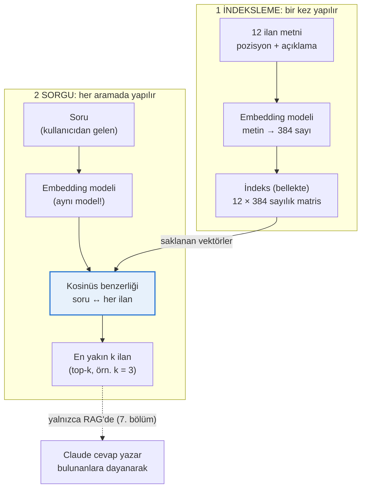

# AI Mühendisliği – Hafta 4: Embedding ve Anlamsal Arama

Tarih: 2026-11-16

## 1. Bu hafta ne öğreneceksin?

Hafta 3'teki `ilan_ara` aracı **kelime eşleştirmesiyle** çalışıyordu: "Django" yazarsan, içinde tam olarak "Django" geçen ilanları buluyordu. Ama insanlar ne istediklerini hep aynı kelimelerle söylemez. Bu hafta aramayı **kelimeye göre** değil **anlama göre** yapmayı öğreniyoruz: "web uygulaması yazacak biri" diye aradığında, metinde "web" kelimesi geçmese bile ilgili ilanları bulabilmeyi. Bunun aracı **embedding**, yöntemi **anlamsal arama (semantic search)**.

**Büyük resim:** Bir sonraki bölümlerde göreceğin **RAG** (Retrieval-Augmented Generation, "arayarak zenginleştirilmiş üretim") iki yarıdan oluşur: **önce uygun bilgiyi bul (retrieval), sonra modelin cevap yazması için ona ver (generation).** Bu hafta ikisini de küçük ölçekte yapıyoruz; asıl ağırlık bulma kısmında.

**Bu haftanın sonunda şunları yapabileceksin:**

- Bir metni embedding'e (sayı listesine) çevirmek ve ne işe yaradığını açıklamak
- İki metnin anlamca ne kadar yakın olduğunu kosinüs benzerliğiyle ölçmek
- Bir ilan koleksiyonunda anlamsal arama yapmak ve bunu kelime aramasıyla karşılaştırmak
- Bulunan ilanları Claude'a verip kaynak gösteren bir cevap yazdırmak (mini RAG)
- Bu yöntemin sınırlarını (eşik, uzun metin, Türkçe, yanlış ama yakın sonuç) bilmek

**Nasıl çalışmalı:** Hafta 3'teki gibi her kavram önce bir benzetmeyle, sonra gerçek kodla ve gerçek çıktıyla anlatılır. 2–4. bölümleri kodu çalıştırmadan önce oku; sonra script'leri sırayla çalıştırıp çıktıları karşılaştır. Sonda sözlük ve "kendini sına" soruları var.

**Hafta sonu çıktısı:** `hafta4/` klasöründe ortak bir veri dosyası ve 3 script (embedding üretme, anlamsal arama, mini RAG) ve bu doküman.

**Ön hazırlık**

- [ ] Hafta 3 script'leri çalışıyor ve commit'lendi (`git status -s` temiz)
- [ ] Yeni paketler kuruldu: `.venv/bin/pip install -r requirements.txt` (`fastembed` ve `numpy` eklendi)
- [ ] İlk çalıştırmada embedding modeli **bir kez indirilir** (~0,22 GB); sonraki çalıştırmalarda disk önbelleğinden gelir

**Maliyet notu:** Embedding'leri bu hafta **kendi bilgisayarında** üretiyoruz, yani araç olarak API ücreti yok. Yalnızca 7. bölümdeki mini RAG, cevabı yazmak için Claude'u (Haiku) birkaç kez çağırır; bu da birkaç sent tutar.

## 2. Önce sorun: anahtar kelime aramasının sınırı

Hafta 3'teki `ilan_ara` aracı bir kelimeyi metnin içinde **aynen** arıyordu. Bu, klavyede `Ctrl+F` yapmaya benzer: yazdığın harfler orada yoksa bulamaz. Gerçek hayatta ise insanlar aynı şeyi farklı kelimelerle söyler.

**Benzetme: katalog fişi ve kütüphaneci**

Bir kütüphanede iki yol düşün. Birincisi kitap fişi dolabı: "oto" yazan fişe bakıyorsun, kitabın başlığında tam olarak "oto" yoksa o kitaba ulaşamıyorsun. İkincisi bir kütüphaneci: "Motorlu taşıtlar hakkında bir şey arıyorum" diyorsun, "oto", "arabalar" ya da "tır" kelimeleri geçse de sana doğru rafları gösteriyor, çünkü ne demek istediğini **anlıyor**. Anahtar kelime araması fiş dolabı, anlamsal arama kütüphaneci.

**Anahtar kelime aramasının üç sınırı**

| Sınır | Örnek |
| --- | --- |
| Eş anlamlı sözcükleri kaçırır | Sen "evden çalışmak" dersin, ilan "uzaktan çalışırsın" der |
| Ek ve çekimlerde takılır (Türkçede özellikle) | "uygulamaları" kelimesi "uygulama" aramasıyla tam eşleşmez |
| İlgisiz sözcükleri eşleştirir | "arıyoruz" her ilanda geçer, bu yüzden alakasız sonuç verir |

**Gerçek örnekler.** Kod `hafta4/02_anlamsal_arama.py` içinde, 12 örnek ilan üzerinde. Anahtar kelime tabanı bilerek basit tutuldu: sorgudaki 4 harften uzun kelimelerin ilanda **tam olarak** geçip geçmediğine bakıyor.

| Sorgu | Anahtar kelime araması ne buldu? | Ne olmalıydı? |
| --- | --- | --- |
| "evden çalışabileceğim ön yüz işi" | **Hiçbir şey** (eşleşme yok) | #2 Frontend Geliştirici ("kullanıcı arayüzleri", "tamamen uzaktan") |
| "telefon uygulaması yapmak" | **Hiçbir şey** (eşleşme yok) | #6 Mobil Geliştirici ("iOS hem Android", "Flutter") |
| "aşçı arıyoruz" | **3 ilan buldu** (#1, #2, #3) | Hiçbiri; eşleşen tek kelime "arıyoruz" |

Yani aynı yöntem hem **kaçırdı** (ilk iki satır) hem **yanlış buldu** (son satır). Gelişmiş arama motorları kelime kökünü bulma gibi yollarla bu sorunu bir miktar azaltır; burada gösterilen, basit bir karşılaştırmadır, ama temel sınır (anlam yerine harfe bakmak) aynıdır.

## 3. Embedding nedir? Anlam haritasındaki bir koordinat

Bilgisayar metnin anlamını doğrudan karşılaştıramaz; ama **sayıları** karşılaştırabilir. **Embedding**, bir metni (cümle, paragraf, ilan) anlamını temsil eden uzun bir **sayı listesine (vektöre)** çeviren bir dönüşümdür. Anlamı yakın metinlerin sayı listeleri de birbirine yakın çıkar.

**Benzetme: anlam haritası**

Bir harita düşün; ama şehirleri değil **cümleleri** yerleştiriyor. Her cümlenin haritada bir yeri, yani bir **koordinatı** var. "Python ile web sitesi geliştirmek" ile "Django kullanarak web uygulaması yazmak" haritada birbirinin yanında durur; "Kedi mamasını rafa koydum" ise çok uzakta. Bir ilan ararken yaptığın şey, soruyu da haritaya koyup **en yakın komşularına bakmak**. Normal bir harita iki sayıyla (enlem, boylam) tarif edilir; anlam haritası ise çok daha fazla sayıyla. Bizim modelimizde her metin **384 sayıyla** tarif ediliyor.

**Bu sayılar nereden geliyor?** Bir **embedding modeli** üretir. Bu, Claude gibi bir dil modeli değildir: metin yazmaz, yalnızca bir metni sayı listesine çevirir. Eğitimde "anlamı yakın metinler yakın, uzak olanlar uzak düşsün" diye öğretilmiştir. Bu hafta kullandığımız model:

| Özellik | Değer (gerçek ölçüm) |
| --- | --- |
| Model | `paraphrase-multilingual-MiniLM-L12-v2` (nicemlenmiş ONNX sürümü, `fastembed` ile) |
| Vektör boyutu | 384 sayı |
| Diller | Çok dilli (Türkçe dahil) |
| Boyut / konum | ~0,22 GB indirme, bilgisayarında çalışır, API ücreti yok |

**Not:** Anthropic'in kendi embedding modeli yok; Claude'la birlikte kullanılması önerilen sağlayıcı Voyage AI (arama sonuçlarında Anthropic dokümanının bunu önerdiğini gördüm; sayfayı açıp doğrulamadım). Üretimde genellikle bir bulut embedding API'si ya da daha güçlü bir model seçilir; biz öğrenme için küçük ve yerel olanı kullanıyoruz.

**LLM yazısıyla bağlantı:** ["LLM Nasıl Çalışır"](../referans/llm-nasil-calisir.md) notunda her **token** bir embedding'e dönüşüyordu. Buradaki embedding aynı fikrin bir adım üstü: tek bir token değil, **metnin tamamı** için tek bir vektör üretiliyor. İkisinde de anlam, uzaydaki konumdur.

Aşağıdaki çizim bu fikri iki boyuta indirip gösteriyor. Gerçek uzay 384 boyutludur, bir çizime sığmaz; çizim yalnızca sezgi içindir.

```
   yazılım ve sunucu işleri                       Bugün hava çok güzel o
     o Python ile web sitesi geliştirmek               \  0,90
        \  0,62                              The weather is very nice today o
         o Django kullanarak web uygulaması yazmak
    ◆ sorgu: "web uygulaması yazacak biri"  (kesikli çizgiler: en yakın komşular)
     o Bulut sunucularını yönetmek                       Kedi mamasını rafa koydum o
                                                         (Python cümlesiyle benzerlik: 0,07)
```

Haritada **yakın noktalar** anlamca yakın cümlelerdir: iki web cümlesi yan yana (0,62), Türkçe ve İngilizce hava cümlesi neredeyse üst üste (0,90), kedi cümlesi ise çok uzakta. Soruyu da bu haritaya koyup en yakın komşularına bakarız; **arama** tam olarak budur. (Şematik çizim; mesafeler ölçekli değildir, 0,62 / 0,90 / 0,07 gerçek ölçümlerdir.)

## 4. Benzerlik nasıl ölçülür? Kosinüs benzerliği

Haritada iki noktanın "yakın" olup olmadığını iki yolla ölçebilirsin: aralarındaki **mesafeye** bakarak ya da noktaları orijinden çıkan birer **ok** gibi düşünüp okların **aynı yöne bakıp bakmadığına** bakarak. Metin embedding'lerinde en yaygın yöntem ikincisidir ve **kosinüs benzerliği** (cosine similarity) denir.

**Benzetme: iki el feneri**

Bir odanın ortasından iki el feneri tuttuğunu düşün. İkisi de aynı duvara bakıyorsa "aynı yön", benzerlik 1'dir. Biri sağa, diğeri tavana bakıyorsa aralarında 90 derece vardır, benzerlik 0'dır. Zıt yönlere bakıyorlarsa benzerlik -1'dir. Fenerin **ne kadar parlak ya da uzun** olduğu fark etmez, yalnızca **nereye baktığı** önemlidir. Bu bizim için iyi bir özellik: uzun bir ilan metni, kısa bir ilandan sadece uzun olduğu için "daha benzer" sayılmaz.

Formül olarak, iki vektörün çarpımının (nokta çarpımı), uzunluklarının çarpımına bölümüdür:

```latex
\cos(\theta) = \frac{a \cdot b}{\lVert a \rVert \, \lVert b \rVert}
```

**Küçük bir el hesabı** (iki boyutlu, sayıları kolay olsun diye):

| Vektörler | Nokta çarpımı | Uzunluklar | Kosinüs | Anlamı |
| --- | --- | --- | --- | --- |
| a = (1, 0) ve b = (1, 1) | 1 | 1 ve √2 (≈1,414) | 1 / 1,414 ≈ **0,71** | Aralarında 45° var, orta derecede benzer |
| a = (1, 0) ve c = (0, 1) | 0 | 1 ve 1 | **0** | Dik, ilgisiz |
| a = (1, 0) ve d = (−1, 0) | −1 | 1 ve 1 | **−1** | Zıt yön |

Kodda bunun karşılığı tek satır (`hafta4/ortak.py`):

```python
def kosinus(a, b):
    return float(np.dot(a, b) / (np.linalg.norm(a) * np.linalg.norm(b)))
```

`np.dot` nokta çarpımını, `np.linalg.norm` vektörün uzunluğunu verir. Embedding'lerde vektörler 384 boyutlu olduğu için hesap aynı, sadece 384 sayı üzerinden yapılır.

**Skoru nasıl yorumlamalı?** Bir sonraki bölümde göreceğin gerçek ölçümlerde bu modelin skor aralığı şöyleydi: eş anlamlı cümle çifti (Türkçe ve İngilizce aynı cümle) **0,90**, yakın anlamlı cümleler **0,62**, gevşek ilişkili **0,21**, ilgisiz **0,07 ve altı**. Ama bu aralık **modele özeldir**: başka bir modelde 0,5 "çok benzer", 0,9 "sıradan" olabilir. Bir skoru tek başına değil, aynı modelin diğer skorlarıyla **karşılaştırarak** yorumla.

## 5. Uygulama 1: embedding üretmek ve benzerliği ölçmek

Bu script (`hafta4/01_embedding_nedir.py`) altı cümleyi vektöre çevirir ve her çifti karşılaştırır. Cümleleri bilerek seçtim: çok yakın, orta, ilgisiz ve farklı dilde aynı anlam.

```python
CUMLELER = [
    "Python ile web sitesi geliştirmek",          # 0
    "Django kullanarak web uygulaması yazmak",    # 1  (0'a çok yakın anlam)
    "Bulut sunucularını yönetmek",                # 2  (ilgili ama farklı iş)
    "Kedi mamasını rafa koydum",                  # 3  (tamamen ilgisiz)
    "Bugün hava çok güzel",                       # 4
    "The weather is very nice today",             # 5  (4'ün İngilizcesi: aynı anlam, başka dil)
]
vektorler = embed_et(CUMLELER)       # (6, 384) bir matris: her satır bir cümlenin vektörü
```

```bash
.venv/bin/python hafta4/01_embedding_nedir.py
```

**Çıktı** (benim çalıştırmam; seçilmiş çiftler aşağıdaki tabloda):

```
Matris sekli: (6, 384)  -> 6 cumle, her biri 384 sayi
Ilk cumlenin ilk 5 sayisi: [-0.2715 -0.2563 -0.1672 -0.1032 -0.2332]
Ilk cumlenin vektor uzunlugu (norm): 4.559

Kosinus benzerligi (satir x sutun):
        [0]   [1]   [2]   [3]   [4]   [5]
  [0]   1.00  0.62  0.21  0.07 -0.05 -0.05
  [1]   0.62  1.00  0.33  0.01 -0.07 -0.06
  [2]   0.21  0.33  1.00 -0.02  0.08  0.11
  [3]   0.07  0.01 -0.02  1.00  0.02 -0.05
  [4]  -0.05 -0.07  0.08  0.02  1.00  0.90
  [5]  -0.05 -0.06  0.11 -0.05  0.90  1.00
```

**Çıktıyı satır satır okuyalım**

- **`(6, 384)`:** Altı cümle, her biri 384 sayı oldu. Bu, "metinden vektöre" dönüşümün sonucu.
- **İlk 5 sayı (`-0.2715 ...`):** Tek başına hiçbir şey ifade etmez. Sayılar yalnızca **başka vektörlerle karşılaştırılınca** anlam kazanır; bu yüzden onlara bakarak "bu cümle nedir" diyemezsin.
- **Vektör uzunluğu 4,559:** Vektörün uzunluğu 1 değil (normalleştirilmemiş). Kosinüs benzerliği uzunluğu zaten yok sayıyor, o yüzden bu bizi etkilemiyor.
- **Köşegen 1,00:** Her cümle kendisiyle aynı yönde, benzerlik tam 1. Tablo aynı zamanda **simetrik**: [0]↔[1] ile [1]↔[0] aynı.

**Seçilmiş çiftler**

| Çift | Kosinüs | Yorum |
| --- | --- | --- |
| "Python ile web sitesi geliştirmek" ↔ "Django kullanarak web uygulaması yazmak" | **0,62** | Anlamca yakın, ama kelimeleri farklı (ortak yalnızca "web") |
| "Python ile web sitesi geliştirmek" ↔ "Bulut sunucularını yönetmek" | **0,21** | Aynı alan, farklı iş: zayıf bağ |
| "Python ile web sitesi geliştirmek" ↔ "Kedi mamasını rafa koydum" | **0,07** | İlgisiz |
| "Bugün hava çok güzel" ↔ "The weather is very nice today" | **0,90** | **Farklı dilde aynı anlam**, en yüksek skor |
| "Bugün hava çok güzel" ↔ "Kedi mamasını rafa koydum" | **0,02** | İlgisiz |

**Bu tablodan çıkan üç ders**

1. **Anlam, kelimeden bağımsız.** İlk çiftin ortak kelimesi yalnızca "web"; yine de 0,62 çıktı.
2. **Çok dillilik gerçek.** Türkçe ve İngilizce aynı cümle 0,90 çıktı; hiç ortak kelimeleri yok. Bu, ilan arayan birinin İngilizce de yazabileceği anlamına gelir.
3. **Skor "ne kadar aynı şeyi söylüyor"u ölçer, "ilgili mi"yi değil.** Çeviri çifti 0,90 alırken yakın ama farklı bilgi veren çift 0,62 aldı. Bu yüzden arama yaparken "0,6"ı kötü değil iyi bir sonuç sayıyoruz; mutlak eşik bir sonraki bölümlerde sorun olacak (8. bölüm).

## 6. Uygulama 2: anlamsal arama ve anahtar kelime araması

Anlamsal arama iki ayrı aşamadan oluşur. **İndeksleme** bir kez yapılır: tüm ilanlar embedding'e çevrilip saklanır. **Sorgu** her aramada yapılır: soru da embedding'e çevrilir ve saklanan vektörlerle karşılaştırılır. **Benzetme:** kütüphanedeki tüm kitapları haritaya bir kez yerleştirmek (indeksleme), sonra her yeni soruyu haritada konumlandırıp en yakın kitaplara bakmak (sorgu). Aşağıdaki çizim bu iki aşamayı gösteriyor.



Çizimde **vurgulu kutu** (kosinüs benzerliği) aramanın kalbi: soru vektörü, saklanan her ilan vektörüyle karşılaştırılır. İndeks bir kez hesaplanıp bellekte durur; her yeni soru yalnızca **tek bir embedding** hesaplatır. Kesikli kutu (cevap yazma) yalnızca RAG'de, 7. bölümde gelir.

Bu hafta kullanacağımız fonksiyonlar `hafta4/ortak.py` içinde, `hafta4/02_anlamsal_arama.py` ise aynı fikri görünür biçimde yazar:

```python
# INDEKSLEME: bir kez
INDEKS = embed_et([f"{i['pozisyon']}. {i['metin']}" for i in ILANLAR])   # (12, 384)

# SORGU: her aramada
def anlamsal_ara(sorgu, k=3):
    q = embed_et([sorgu])[0]                                   # sorunun vektörü
    puanlar = [(kosinus(q, v), ilan) for v, ilan in zip(INDEKS, ILANLAR)]
    puanlar.sort(key=lambda x: -x[0])                          # en benzer önce
    return puanlar[:k]                                          # en yakın k ilan
```

```bash
.venv/bin/python hafta4/02_anlamsal_arama.py
```

İndeks 12 ilan için **0,97 saniyede** (model yükleme dahil) hazırlandı. Beş sorgunun gerçek sonuçları (benim çalıştırmam, ilk 3 sonuç):

| Sorgu | Anahtar kelime araması | Anlamsal arama (kosinüs skoru) |
| --- | --- | --- |
| "Python web uygulamaları yazıyorsun" | #1, #3, #8 (her biri 1 ortak kelime) | #8 AI Mühendisi **0,60**, #3 Python **0,57**, #1 Backend **0,57** |
| "evden çalışabileceğim ön yüz işi" | **Eşleşme yok** | #2 Frontend **0,33** ✓, #4 Full Stack 0,26, #11 Backend 0,26 |
| "yazılımları yayına alma ve sunucu yönetimi" | #4, #5, #11 | #4 Full Stack **0,57**, #11 Backend 0,51, #5 DevOps 0,49 |
| "telefon uygulaması yapmak" | **Eşleşme yok** | #6 Mobil **0,54** ✓, #10 Oyun 0,49, #9 Güvenlik 0,35 |
| "aşçı arıyoruz" (ilgisiz) | #1, #2, #3 (yalnızca "arıyoruz" eşleşti) | #11 0,32, #2 0,31, #4 0,28 |

**Sonuçları okuyalım**

- **Anlamsal arama kazandı:** "ön yüz" ve "telefon uygulaması" sorgularında anahtar kelime hiçbir şey bulamadı; anlamsal arama **doğru ilanı birinci sıraya koydu** (#2 Frontend, #6 Mobil). İlan metinlerinde "ön yüz" ya da "telefon" kelimesi yoktu, sadece "kullanıcı arayüzleri" ve "iOS hem Android" vardı.
- **Sıralama her zaman mükemmel değil:** "Python web uygulamaları" sorgusunda Django kullanan **#4 Full Stack ilanı, 12 ilan içinde 8. sırada (0,36)** kaldı; üstte "Teknik İçerik Yazarı" (0,48) bile vardı. "Yayına alma ve sunucu" sorgusunda DevOps ilanı (#5) birinci değil üçüncü oldu. Bu, küçük ve genel amaçlı bir modelin sınırı olabilir; arama için ayrıca eğitilmiş modeller daha iyi olabilir (bunu denemedim).
- **Arama her zaman bir şey döndürür:** "aşçı arıyoruz" ilgisiz bir sorgu; yine de en yakın üç ilan geldi. Vektör araması "hiçbiri uymuyor" demez, her zaman **en yakın komşuları** verir. Yakın olan, uygun olan demek değildir.
- **Kelime aramasının kendi hatası:** "aşçı arıyoruz" sorgusunda anahtar kelime üç ilan bulur, çünkü "arıyoruz" kelimesi eşleşir. İkisi de yanılıyor, ama farklı nedenlerle.

**Pratik sonuç:** Tek bir yöntem yetmez. Üretimde çoğu zaman ikisi birlikte kullanılır (hibrit arama): kelime eşleşmesi tam terimleri yakalar (örneğin "Django"), anlamsal arama eş anlamlıları yakalar. Hibrit arama ileriki haftalarda.

## 7. Uygulama 3: mini RAG, bulunanlarla cevap yazdırmak

Arama sonuçları kullanıcıya liste olarak gösterilebilir; ama çoğu zaman asıl istenen **bir cevaptır**. RAG tam burada devreye girer: bulunan ilanları modele verirsin, model cevabı onlardan yazar.

**Benzetme: açık kitap sınavı**

Modeli bir sınava sokuyorsun, ama "açık kitap": masasına yalnızca aradığın konuyla ilgili sayfaları koyuyorsun. Kurallar: "Sadece bu sayfalara bak, hangi sayfadan aldığını yaz, sayfalarda cevap yoksa bilmiyorum de." Bu kurallar modelin **uydurmasını** engeller. Retrieval masaya hangi sayfaların konacağını seçer, generation cevabı yazar.

Script: `hafta4/03_mini_rag.py`. İçindeki iki adım:

```python
# 1) BUL: soruya en yakın 3 ilan
bulunanlar = anlamsal_ara(soru, INDEKS, k=3)

# 2) ÜRET: bulunanları bağlam olarak modele ver
baglam = "\n".join(f"[ilan {i['id']}] {i['pozisyon']} - {i['sirket']} ({i['sehir']}): {i['metin']}"
                  for _, i in bulunanlar)
r = client.messages.create(
    model=MODEL, max_tokens=400, system=SYSTEM,
    messages=[{"role": "user", "content": f"<ilanlar>\n{baglam}\n</ilanlar>\n\nSoru: {soru}"}],
)
```

**System prompt'taki kurallar** ve her birinin amacı:

| Kural | Neden var |
| --- | --- |
| "Sadece `<ilanlar>` içindeki bilgilere dayanarak cevap ver" | Modelin kendi bilgisinden uydurmasını engeller (**grounding**, yani cevabı verilen kaynaklara dayandırmak) |
| "Her bilginin yanına kaynak olarak [ilan N] yaz" | Kullanıcı cevabı doğrulayabilir (**kaynak gösterme**) |
| "Cevap ilanlarda yoksa 'bilgi yok' de, tahmin etme" | Retrieval yanlış ilanlar getirirse bile model uydurmaz |

`<ilanlar>` etiketi, bağlam metnini sorudan ayrı tutan bir ayırıcıdır; Claude için bu tür XML etiketleri yaygın bir alışkanlıktır.

```bash
.venv/bin/python hafta4/03_mini_rag.py
```

**Dört sorunun gerçek sonuçları** (benim çalıştırmam, cevapları kısalttım):

| Soru | Bulunan ilanlar (skor) | Modelin cevabı | Girdi / çıktı token |
| --- | --- | --- | --- |
| "Uzaktan çalışabileceğim bir Django işi var mı?" | #4 (0,62), #1 (0,61), #3 (0,45) | **Evet: Nova Bilişim, Full Stack, uzaktan** [ilan 4]; #1'in haftada üç gün ofis gerektirdiğini de belirtti | 415 / 153 |
| "Flutter bilen biri için iş var mı, hangi şehirde?" | #6 (0,36), #5 (0,29), #8 (0,26) | **Evet: Mobil Geliştirici, Mavi Mobil, İstanbul** [ilan 6] | 369 / 95 |
| "Aşçı pozisyonu var mı?" | #11 (0,21), #2 (0,20), #1 (0,18) | **"Verilen ilanlarda bu bilgi yok."** | 404 / 92 |
| "En yüksek maaşı hangi ilan veriyor?" | #7 (0,20), #11 (0,12), #1 (0,12) | **"Verilen ilanlarda bu bilgi yok."** (ilanlarda maaş yazımıyor) | 387 / 50 |

**Sonuçları okuyalım**

- **İlk iki soru:** Retrieval doğru ilanı getirdi (#4 ve #6 en üstte), model de cevabı doğru ve kaynaklı yazdı. Şehir bilgisini (İstanbul) bağlamdaki `sehir` alanından aldı.
- **Üçüncü ve dördüncü soru en önemlisi:** Retrieval her seferinde **bir şey getirdi**, ama getirilenlerin hiçbiri ilgili değildi (skorlar 0,12–0,21). Model buna rağmen **uydurmadı**, "bilgi yok" dedi. Bu, 6. bölümdeki "arama her zaman bir şey döndürür" sorununa karşı **ikinci savunma hattı**: retrieval uygun olmayan sayfalar getirse bile kurallar modelin uydurmasını engelledi.
- **Küçük bir kusur:** Üçüncü cevapta model, olmayan bilgiyi savunurken ilgisiz ilanlara da "[ilan 11], [ilan 2], [ilan 1]" diye atıf yaptı. Kaynak formatları bu tür "yok" cevaplarında gürültülü olabiliyor.
- **Maliyet:** Dört soru toplam 1575 girdi, 390 çıktı token. Haiku 4.5 fiyatıyla (1 $ / 5 $ milyon token başına) yaklaşık **0,0035 dolar**, yani yarım sentten az.

**Dürüst bir not:** Bu veri küçük (12 kısa ilan). Tüm ilanları doğrudan prompta koymak da mümkündü ve daha basit olurdu. RAG'in asıl değeri, **binlerce doküman** olduğunda ortaya çıkar: hepsi prompta sığmaz ya da çok pahalı olur, bu yüzden yalnızca ilgili birkaçını seçersin. Burada fikri küçük ölçekte öğreniyoruz.

## 8. Sınırlar ve tuzaklar

Anlamsal arama güçlü ama sihirli değil. Aşağıdaki tuzakların bir kısmını bu hafta **ölçerek** gördüm; ölçemediklerimi açıkça belirttim.

**Tuzak 1: Uzun metnin sonu kesilir (gerçek ölçüm).** Kullandığımız modelin tokenizer'ı girdiyi **128 token'da** kesiyor ve kesmeyi **sondan** yapıyor. Bunu kanıtlamak için bir deney yaptım: ilgisiz bir cümleyi ("Kedi mamasını rafa koydum.") 60 kez tekrarlayıp **en sonuna** bir ilan cümlesi ("Python ve Django ile backend geliştirici arıyoruz.") ekledim.

| Karşılaştırma | Kosinüs |
| --- | --- |
| Uzun metin (ilan sonda) ↔ yalnızca kedi metni | **1,000** (aynı!) |
| Uzun metin (ilan sonda) ↔ yalnızca ilan cümlesi | **−0,035** (ilgisiz) |
| Uzun metin (ilan başta) ↔ yalnızca ilan cümlesi | 0,588 |
| Uzun metin (ilan başta) ↔ yalnızca kedi metni | 0,695 |

Yani ilan cümlesi sonda olduğu zaman embedding'e **hiç girmedi**. Başta olsa bile uzun gürültü, benzerliği düşürdü (ilanla 0,588, gürültüyle 0,695). **Ders:** Uzun metinleri **parçalara (chunk)** bölmek gerekir; bu Hafta 5'in konusu. Bizim 12 ilanımız kısa olduğu için bu hafta sorun yaşamadık.

**Tuzak 2: Eşik koymak zor (gerçek ölçüm).** "Skor 0,4'ün altındaysa sonuç yok de" demek cazip; ölçümlerimiz bunun çalışmadığını gösteriyor:

| Sorgu | En yüksek skor | Sonuç gerçekten uygun mu? |
| --- | --- | --- |
| "Python web uygulamaları yazıyorsun" | 0,60 | Kısmen (Django ilanı #4 8. sırada) |
| "yazılımları yayına alma ve sunucu yönetimi" | 0,57 | Kısmen (DevOps #5 üçüncü) |
| "telefon uygulaması yapmak" | 0,54 | Evet (#6) |
| "evden çalışabileceğim ön yüz işi" | **0,33** | **Evet** (#2) |
| "aşçı arıyoruz" | **0,32** | **Hayır** (ilgisiz) |

Doğru bulunan "ön yüz" sorgusunun skoru (0,33) ile ilgisiz "aşçı" sorgusunun skoru (0,32) **neredeyse aynı**. Tek bir eşik ikisini ayıramaz. Skorlar mutlak anlam taşımıyor. Bunun yerine: modele "bilgi yoksa söyle" kuralını vermek (7. bölüm), hibrit arama, daha iyi bir model ve **ölçüm** (Hafta 9'daki eval).

**Tuzak 3: En yakın olan, en uygun olan değildir (gerçek ölçüm).** Django kullanan #4 Full Stack ilanı "Python web uygulamaları" sorgusunda 12 ilan içinde 8. sırada (0,36) kaldı. Vektör araması sana "bu cevap" değil "bu en yakın komşular" verir. Sonuçları her zaman ikinci bir gözle kontrol et.

**Tuzak 4: İndeks ile sorgu aynı modelle üretilmeli (temel kural, denemedim).** Her model kendi anlam haritasını çizer. İki farklı modelin vektörleri aynı uzayda değildir; aralarındaki benzerlik anlamsızdır. Modeli değiştirirsen **tüm indeksi yeniden üretmelisin**.

**Tuzak 5: Kesin alanlar (şehir, maaş, tarih) için embedding uygun değildir (gerçek ölçüm).** "İzmir'de ofiste çalışılan bir iş var mı?" sorgusunu iki şekilde denedim: indekse şehri **koymadan** ve **koyarak**. İkisinde de ilk dört sonuç İzmir'den değildi (en yüksek skorlar 0,35–0,36: #11 Bursa, #2 Ankara, #1 İstanbul); gerçek İzmir ilanları (#3 ve #10) ilk dörde girmedi. Benim tahminim "şehri indekse eklersem düzelir"di; **yanlış çıktı**. **Ders:** Embedding **anlamı** yakalar ama "İzmir" gibi kesin bir değere eşitliği güvenilir yakalayamaz. Kesin alanlar için **filtre** kullan: önce `sehir == "İzmir"` ile ilanları ele, sonra kalanlar arasında anlamsal sırala. (Vektör veritabanı dünyasında buna "metadata filtering" denir.)

**Tuzak 6: İndeks bayatlar.** İlan metni değişirse eski embedding artık eski metne ait olur; değişen metinlerin embedding'ini yeniden hesaplamak gerekir.

**Tuzak 7: Veri nereye gidiyor?** Bu hafta kullandığımız yerel modelde metinler bilgisayarından çıkmaz. Bir bulut embedding API'si kullanırsan metinler sağlayıcıya gönderilir; gizli veride bu önemli bir karardır.

**Özet:** Vektör araması "benzer olanı getirir", **doğruluğunu garanti etmez**. Bu yüzden üretimde arama kalitesi ölçülmeli, uzun metin parçalanmalı ve model cevabı kaynaklara bağlanmalı.

## 9. Terimler sözlüğü

Bu haftanın terimleri bir arada. Bir terimi unutursan buraya dön.

| Terim | Ne demek | Kodda ya da dokümanda nerede görürsün |
| --- | --- | --- |
| **Embedding** | Bir metni anlamını temsil eden sayı listesine çeviren dönüşüm (ve çıktısı) | `embed_et(...)` |
| **Vektör** | Sıralı bir sayı listesi; bizde 384 sayı | `vektorler[0]` |
| **Boyut (dimension)** | Vektördeki sayı adedi (384) | `.shape` çıktısı `(6, 384)` |
| **Embedding modeli** | Metni vektöre çeviren model; metin yazmaz, dil modeli değildir | `TextEmbedding` (`fastembed`) |
| **Kosinüs benzerliği** | İki vektörün yön benzerliği, −1 ile 1 arası; 1 = aynı yön | `kosinus(a, b)` |
| **Anlamsal arama** | Kelimeye değil anlama göre arama | `anlamsal_ara(...)` |
| **İndeksleme** | Tüm dokümanların embedding'ini bir kez hesaplayıp saklamak | `indeks_olustur()` |
| **Sorgu (query)** | Soruyu embedding'e çevirip en yakın dokümanları bulmak | `anlamsal_ara(...)` |
| **Top-k** | En yakın k sonuç (bizde k = 3) | `k=3` |
| **RAG** | Retrieval-Augmented Generation: önce ilgili bilgiyi bul, sonra bulunanlarla cevap yaz | `03_mini_rag.py` |
| **Grounding** | Modelin cevabını verilen kaynaklara dayandırması | System prompt kuralları (7. bölüm) |
| **Halüsinasyon (uydurma)** | Modelin kaynakta olmayan bir şeyi "gibi" söylemesi | 7. bölümde "bilgi yok" kuralı bunu azaltır |
| **Chunk (parça)** | Uzun metnin embedding için bölünen küçük parçası | Tuzak 1, Hafta 5 |
| **Metadata filtering** | Şehir gibi kesin alanlara göre önce elemek, kalanları anlamsal sıralamak | Tuzak 5 |
| **Hibrit arama** | Kelime araması ile anlamsal aramayı birleştirmek | 6. bölüm sonu, ileriki haftalar |

## 10. Hafta sonu çıktısı ve egzersizler

`~/projects/ai-engineering/hafta4/` altında ortak bir dosya ve üç script var.

| Dosya | Ne gösteriyor | Akılda kalacak sonuç |
| --- | --- | --- |
| `ortak.py` | 12 örnek ilan, embedding modeli, `embed_et`, `kosinus`, `indeks_olustur`, `anlamsal_ara` | Arama, embedding + kosinüs + sıralamadan ibaret |
| `01_embedding_nedir.py` | 6 cümleyi vektöre çevirip benzerliği ölçme | Anlam kelimeden bağımsız; Türkçe–İngilizce aynı cümle 0,90 |
| `02_anlamsal_arama.py` | Anlamsal arama ile anahtar kelime aramasını karşılaştırma | "Ön yüz" ve "telefon" sorgularını sadece anlamsal arama buldu; ama sıralama kusurlu |
| `03_mini_rag.py` | Bulunan ilanlarla kaynaklı cevap yazdırma | "Bilgi yok" kuralı uydurmayı engelledi |

Sırayla çalıştırmak için (`ai-engineering` klasöründen; `01` ve `02` API anahtarı gerektirmez):

```bash
.venv/bin/python hafta4/01_embedding_nedir.py
.venv/bin/python hafta4/02_anlamsal_arama.py
.venv/bin/python hafta4/03_mini_rag.py
```

**Egzersizler (her birinde önce tahminini yaz, sonra dene):**

| Egzersiz | Ne yapacaksın | Ne gözlemleyeceksin |
| --- | --- | --- |
| **Kendi sorguların** | `02` içindeki `SORGULAR` listesine kendi 3 sorgunu ekle (biri tamamen ilgisiz olsun) | İlgili ve ilgisiz sorguların en yüksek skorları ne kadar ayrılıyor? Bir eşik seçilebilir mi? |
| **Şehir filtresi** | `anlamsal_ara`'ya `sehir` parametresi ekle: önce `sehir` eşit olan ilanları ele, kalanları sırala. "İzmir'de ofiste çalışılan bir iş var mı?" diye sor | Tuzak 5'teki sorun çözüldü mü? #3 ve #10 üstte mi? |
| **k değiştir** | `03` içinde `k=1` ve `k=5` dene, "Uzaktan bir Django işi var mı?" sorusunu sor | `k=1` iken hangi bilgi kayboluyor? `k=5` iken cevap gürültülü mü? |
| **Kuralı çıkar** | `03` içindeki system prompt'tan "bilgi yoksa söyle, tahmin etme" cümlesini sil ve "Aşçı pozisyonu var mı?" diye sor | Model ne cevap veriyor? Uydurma gerçekleşiyor mu? |
| **Hibrit mini deney** | `02` içinde puan = 0,7 × anlamsal + 0,3 × (ortak kelime sayısı / 3) olacak şekilde birleştir; "Python web uygulamaları" sorgusunu dene | #4 Full Stack'in sırası değişiyor mu? |
| **Uzun ilan** | Bir ilanı 300 kelimeye uzat, önemli bilgiyi **sona** koy, ara | Tuzak 1'deki gibi bilgi kayıp mı? |

Bu hafta yazdığın arama, job-radar fikrinin **bulma motorunun** ilk halidir: ilan koleksiyonu, anlam bazlı arama ve kaynaklı cevap. Hafta 5'te bunu büyük veriye ve kalıcı bir veritabanına taşıyacağız.

## 11. Kendini sına

Cevapları aşağıdan önce kendin yazmaya çalış:

1. Embedding nedir ve iki metnin vektörlerini neden karşılaştırırız?
2. Kosinüs benzerliği neyi ölçer, neyi önemsemez?
3. "evden çalışabileceğim ön yüz işi" sorgusunu anahtar kelime araması neden bulamadı; anlamsal arama nasıl buldu?
4. İndeksleme ile sorgu arasındaki fark nedir? Hangisi her aramada çalışır?
5. "Aşçı arıyoruz" gibi ilgisiz bir sorguya da sonuç geldi. Vektör araması neden "sonuç yok" demez?
6. Tek bir skor eşiği neden güvenilir değil?
7. Mini RAG'de modelin "bilgi yok" demesini ne sağlıyor?
8. Uzun bir ilanın sonundaki bilgi neden aramada bulunamayabilir?

**Cevaplar:**

1. Embedding, bir metni anlamını temsil eden sayı listesine (vektöre) çevirir. Anlamı yakın metinlerin vektörleri de yakın olduğu için vektörleri karşılaştırarak metinlerin anlamca ne kadar yakın olduğunu ölçebiliriz.
2. İki vektörün **yönünü** karşılaştırır (−1 ile 1 arası). Vektörün **uzunluğunu** önemsemez; yani uzun bir metin sadece uzun olduğu için daha benzer sayılmaz.
3. İlan metninde "ön yüz" ya da "evden" kelimesi yoktu ("kullanıcı arayüzleri", "uzaktan" yazıyordu); anahtar kelime harfe baktığı için bulamadı. Anlamsal arama anlamı karşılaştırdığı için #2 Frontend ilanını birinci sıraya koydu.
4. İndeksleme tüm ilanların embedding'ini bir kez hesaplayıp saklar. Sorgu ise her aramada, sorunun embedding'ini hesaplayıp saklanan vektörlerle karşılaştırır. Her aramada **sorgu** çalışır.
5. Vektör araması "en yakın k komşuyu" döndürür; yakınlık çok düşük olsa bile bir sıralama vardır. Uygunluğu kendisi bilmez.
6. Skorlar mutlak anlam taşımıyor: doğru bulunan "ön yüz" sorgusu 0,33, ilgisiz "aşçı" sorgusu 0,32 aldı. Tek eşik ikisini ayıramaz.
7. System prompt'taki kurallar: sadece verilen ilanlara dayan, kaynak göster, cevap yoksa "bilgi yok" de ve tahmin etme (grounding).
8. Model girdiyi 128 token'da sondan kesiyor; uzun metnin sonundaki bilgi embedding'e hiç girmiyor. Çözüm metni parçalara (chunk) bölmek (Hafta 5).

## 12. Sık hatalar ve hızlı başvuru

| Belirti | Neden | Çözüm | Durum |
| --- | --- | --- | --- |
| "You are sending unauthenticated requests to the HF Hub..." uyarısı | Model HuggingFace'ten anonim indiriliyor | Zararsız; yalnızca indirme hız sınırı hakkında bir uyarı, hata değil | **Gördüm** |
| Model her bilgisayar açılışında yeniden iniyor | `fastembed` önbelleği varsayılan olarak `/tmp/fastembed_cache` içinde tutuyor | `cache_dir` ile kalıcı klasör ver (`ortak.py` içindeki `ONBELLEK`, `~/.cache/fastembed`) | **Gördüm** (önbellek konumunu) |
| Uzun ilanın sonundaki bilgi bulunamıyor | Model girdiyi 128 token'da sondan kesiyor | Metni parçalara (chunk) böl (Hafta 5) | **Ölçtüm** |
| Arama hep alakasız sonuçlar getiriyor | İndekslenen metin soruyla örtüşmüyor ya da model sıralamada zayıf | Kesin alanlar için filtre kullan, birkaç test sorgusuyla sıralamayı ölç, gerekirse daha güçlü model dene | **Ölçtüm** (şehir ve sıralama deneyleri) |
| `ModuleNotFoundError: No module named 'ortak'` | Script `python -m ...` ile ya da başka bir yoldan çalıştırıldığında `hafta4/` klasörü arama yoluna girmez | `.venv/bin/python hafta4/02_anlamsal_arama.py` biçiminde çalıştır | Bilinen davranış, denemedim |
| `model.embed(...)` sonucunu doğrudan yazdırınca "generator object" | `embed` bir üretece (generator) döner | `list(...)` ya da `np.array(list(...))` (`embed_et` bunu yapar) | Bilinen davranış, denemedim |
| Anlamsız skorlar ya da boyut hatası | İndeksi bir modelle, sorguyu başka modelle ürettin | İkisi de aynı modelle üretilmeli; model değişince indeksi yeniden üret | Bilinen kural, denemedim |

**Minimum kalıp** (unutursan buradan kopyala; `ai-engineering` klasöründen `hafta4/` içinde çalıştırılan bir script için):

```python
from ortak import indeks_olustur, anlamsal_ara

INDEKS = indeks_olustur()                          # bir kez
for puan, ilan in anlamsal_ara("sorgu", INDEKS, k=3):
    print(f"{puan:.2f}", ilan["pozisyon"])          # puan: kosinüs benzerliği, ilan: sözlük
```

## 13. Kaynaklar ve sıradaki hafta

**Bu hafta için kaynaklar**

- [Anthropic: Embeddings](https://platform.claude.com/docs/en/build-with-claude/embeddings.md): Claude'la birlikte embedding kullanımı ve önerilen sağlayıcı (adresi arama sonuçlarında gördüm, sayfayı açıp doğrulamadım)
- [paraphrase-multilingual-MiniLM-L12-v2 model sayfası](https://huggingface.co/sentence-transformers/paraphrase-multilingual-MiniLM-L12-v2) ve [Qdrant'ın ONNX sürümü](https://huggingface.co/Qdrant/paraphrase-multilingual-MiniLM-L12-v2-onnx-Q): kullandığımız modelin kartı (adresleri arama sonuçlarında gördüm, açmadım)
- ["LLM Nasıl Çalışır"](../referans/llm-nasil-calisir.md) referans notu: token embedding'inin LLM içinde nasıl kullanıldığını hatırlamak için "Adım 3: Embedding" bölümüne bak

Kodlar gerçekten çalıştırıldı (fastembed 0.9.1, numpy 2.5.5, Haiku 4.5); yukarıdaki bağlantıların hiçbirini açıp doğrulamadım.

**Hafta 5: Parçalama (chunking) ve pgvector**

Bu haftaki sistemin üç sınırı var: **(1)** indeks bellekte durur ve her çalıştırmada yeniden hesaplanır, **(2)** uzun metin 128 token'da kesilir, **(3)** şehir gibi kesin alanlara filtre yok. Gelecek hafta bunları çözeceğiz: uzun metni **parçalara (chunk)** bölmeyi, vektörleri **PostgreSQL + pgvector** gibi kalıcı bir veritabanında saklamayı ve SQL ile hem filtre hem benzerlik araması yapmayı öğreneceğiz. Proje notlarında bu bilgisayarda Docker ve Postgres'in kurulu olmadığı yazıyor; Hafta 5'te kurulumu ya da bir alternatifi birlikte seçeceğiz.
