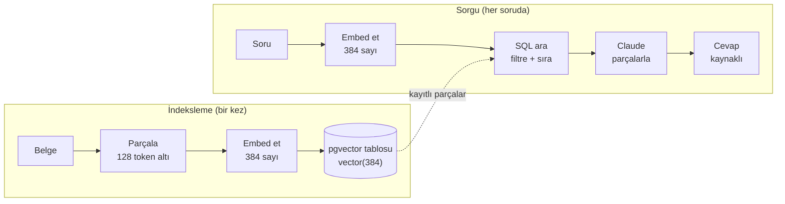

# AI Mühendisliği – Hafta 5: Chunking ve pgvector

Tarih: 2026-11-18

Bu not, Claude Docs'taki "Hafta 5" dokümanının aynasıdır; çizimler mermaid ile yeniden çizilmiştir. Tüm çıktılar `hafta5/` script'lerinin 18 Kasım 2026'da bu bilgisayarda çalıştırılmasından alınmıştır.

## 1. Bu hafta

Hafta 4'te embedding ile anlamsal aramayı kurduk, ama kendi ölçümlerimiz üç borç bıraktı:

| Hafta 4'te ne gördük | Bu hafta ne yapıyoruz |
| --- | --- |
| Model girdinin yalnızca ilk 128 token'ını görüyor; uzun metnin sonu vektöre hiç girmiyor. | **Chunking:** uzun belgeyi modelin görebileceği anlamlı parçalara böleriz. |
| 12 ilanı bellekteki bir numpy matrisinde tuttuk; program kapanınca kayboluyor, binlerce kayıtta her aramada hepsini taramak gerekir. | **pgvector:** vektörleri PostgreSQL'de saklar, SQL ile ararız. |
| "İzmir'de iş var mı?" sorusunu embedding çözemedi; şehir gibi kesin alanlar anlamsal aramanın işi değil. | **Metadata filtresi:** şehri `WHERE` ile süzer, anlamı vektöre bırakırız. |

**Haftanın yolu**

1. Uzun bir belgenin modele neden sığmadığını ölçeriz (2. bölüm).
2. Üç parçalama stratejisini aynı belgede deneriz ve hangisinin cevabı daha iyi bulduğunu sayarız (3 ve 4. bölüm).
3. Parçaları pgvector tablosuna yazar, SQL ile ararız (5 ve 7. bölüm).
4. Şehir filtresi ve indeks ekleriz (8. bölüm), sonra mini RAG'i yeni sistemle yeniden kurarız (9. bölüm).

**Önkoşul:** Hafta 4'ü bitirmiş olmak. Aynı `fastembed` modelini (384 boyut, çok dilli) kullanacağız; yeni API anahtarı ya da ücret yok. Chunking kısmı başka bir kurulum gerektirmez; pgvector kısmı için bir PostgreSQL gerekir (6. bölüm).

**Süre:** okumak ve çalıştırmak yaklaşık 2 saat, egzersizler 30–45 dakika.

## 2. Neden parçalıyoruz: tek vektöre sığmayan belge

Uzun bir belgeyi tek bir vektöre sığdırmak, bir kitabın tamamını tek bir etikete sığdırmaya benzer. Etikete "şirket el kitabı" yazarsın; ama "ihbar süresi kaç hafta?" diye soran biri bu etiketten hangi sayfaya bakacağını anlayamaz. Doğru yöntem her bölüme ayrı etiket yapmaktır. Chunking tam olarak budur: belgeyi **parçalara (chunk)** böl, her parçayı ayrı embed et, soruya en yakın parçayı getir.

### Bir ölçümle görelim

`hafta5/ortak.py` içinde uydurma bir şirket el kitabı var (`EL_KITABI`): izin, uzaktan çalışma, ekipman, kod süreci, nöbet, yan haklar ve işten ayrılma. Cevaplar belgenin farklı yerlerine dağıtıldı.

```bash
cd hafta5
python 02_chunk_arama_olcumu.py
```

Gerçek çıktının son iki satırı:

```text
Belge 736 token; vektor yalnızca ilk 128 tanesini (%17) gördü.
Belge vektoru ile 'sadece ilk 128 token' vektoru arasındaki benzerlik: 1.000
```

- **736 token:** belge 3307 karakter; modelin tokenizer'ı bunu 736 parçaya ayırdı (yaklaşık 4,5 karakter bir token).
- **%17:** model en fazla 128 token görür (Hafta 4, Tuzak 3). Belgenin kalan %83'ü vektöre **hiç girmedi**.
- **1.000:** tüm belgenin vektörü ile yalnızca ilk 128 token'ın vektörü aynı çıktı. Kesme sessizce oluyor; hata yok, uyarı yok.

Bu token sayıları embedding modelinin kendi sayımıdır; Claude'un token sayımıyla aynı değildir.

### Sorulara etkisi

Her soru için iki benzerlik ölçtük: soru ile tüm belgenin vektörü, soru ile en iyi parçanın vektörü.

| Soru | Tüm belge | En iyi parça |
| --- | --- | --- |
| Yıllık izin kaç gün? | 0,42 | 0,67 |
| Evden çalışırsam internet masrafım karşılanıyor mu? | 0,12 | 0,50 |
| Gece canlı sistemde hata çıkarsa kim bakıyor? | 0,14 | 0,30 |
| İşten ayrılırken ihbar süresi ne kadar? | 0,37 | 0,77 |
| Kurs ve konferanslar için ne kadar bütçem var? | 0,24 | 0,54 |
| Dizüstü bilgisayarım ne zaman yenilenir? | 0,21 | 0,58 |
| Kodumu birleştirmeden önce kaç kişi inceliyor? | 0,32 | 0,48 |

Yedi sorunun yedisinde de parçanın puanı daha yüksek. Üstüne tek vektör cevabın belgenin neresinde olduğunu söylemez; RAG'de LLM'e belgenin tamamını vermek zorunda kalırsın, parça ile yalnızca ilgili birkaç paragrafı verirsin.

**Dikkat:** ihbar sorusunda belge puanı 0,37 çıktı, oysa ihbar bölümü belgenin en sonunda ve vektöre hiç girmedi. Puan, cevabın belgede gerçekten bulunduğunu göstermez; benzerlik puanı bir sıralama aracıdır, doğrulama değil.

**Bu bölümün özeti:** model uzun belgeyi tek seferde göremez ve belgenin başı dışında kalan her şey sessizce atılır. Çözüm belgeyi her biri 128 token'ın altında kalan parçalara bölmektir.

## 3. Chunking stratejileri

Bir pastayı dörde bölmek istediğini düşün. İki yolu var: cetvelle her 5 santimde bir kesmek ya da pastanın kendi katmanlarının sınırından kesmek. Cetvel hızlı ve basittir ama bir çileği, kremayı ortadan ayırabilir. Metinde de durum aynıdır; ayırdığın her parça kendi başına bir anlam taşımalı ki embedding o anlamı yakalayabilsin.

### Üç temel strateji

| Strateji | Nasıl kesilir | Güçlü yanı | Zayıf yanı |
| --- | --- | --- | --- |
| **Sabit boyut** | Her N karakterde (ya da token'da) bir | Yazımı çok basit, parça boyutu öngörülebilir | Cümleyi, hatta kelimeyi ortasından keser; başlık bağlamını kaybeder |
| **Sabit boyut + örtüşme (overlap)** | Her parça bir öncekinin son M karakterini tekrar eder | Sınırda kalan bilgi iki parçada birden bulunur | Parça sayısı ve depolama artar; aynı cümle iki sonuçta dönebilir |
| **Yapıya göre (bölüm / paragraf / cümle)** | Başlık ve cümle sınırlarında; çok uzun bölümler cümle sınırından bölünür | Her parça kendi başına okunabilir, başlık parçanın başına yazılabilir | Belgenin yapısı olmalı (başlık, paragraf); düz metinde bulmak zor, parça boyutları eşit olmaz |

Aşağıdaki çizim aynı metnin üç yolla nasıl kesildiğini gösterir. Şematiktir, ölçekli değildir; gerçek sonuçları 4. bölümde göreceksin.

```text
Metin:  [Evden çalışmayı | seçen herkese aylık 600 TL ... ödenir.] [Ekipman: Her yeni ...]

Sabit boyut        : [..Evden çalışmayı ]|[seçen herkese aylık 600 TL..]     <- cümle ortadan kesildi
Sabit + örtüşme    : [..Evden çalışmayı seçen]                          <- ikinci parça bir
                     [çalışmayı seçen herkese aylık 600 TL..]         <- öncekinin kuyruğunu taşır
Yapıya göre        : [Uzaktan çalışma: Evden çalışmayı seçen ... ödenir.]  <- cümle bütün, başlık başta
                     [Ekipman: Her yeni çalışana ...]
```

### Hangi sayıları seçeriz?

Chunking'in iki ayarı vardır: **parça boyutu** ve **örtüşme**. İkisi için de evrensel bir doğru yok; görünen sınırlar şunlar:

- **Üst sınır modelden gelir.** Bizim modelde 128 token. Bir parça bundan uzunsa sonu embedding'e girmez. Boyutu karakterle değil token'la düşün; Türkçede 500 karakter yaklaşık 110–120 token eder (aşağıdaki ölçüm). Başka bir modelin sınırı farklıdır; modelin dokümanlarına bak.
- **Alt sınır anlamdan gelir.** Çok küçük bir parça (tek cümle gibi) bağlamını kaybeder: "Bu süre 20 iş gününe çıkar" cümlesi hangi süreden bahsettiğini bilmez.
- **Örtüşme genellikle parçanın küçük bir yüzdesidir.** Burada 500 karakterlik parçada 100 karakter (%20) denedik. Bu oran bir kural değil, başlangıç noktasıdır; kendi verinde ölçmelisin.

**Bu bölümün özeti:** Üç strateji var. En basiti sabit boyut, en güvenlisi yapıya göre kesmek; örtüşme ikisinin arasındaki ucuz bir sigortadır. Hangisinin iyi olduğunu varsayma, ölç: sonraki bölüm.

## 4. Uygulama 1: üç stratejiyi ölçmek

İki script çalıştırıyoruz. İkisi de `fastembed` modeliyle yerelde çalışır, veritabanı gerektirmez. Aynı el kitabını dört yolla parçalayıp (`01_chunking_stratejileri.py`), sonra yedi soruyla hangisinin cevabı daha iyi bulduğunu sayıyoruz (`02_chunk_arama_olcumu.py`).

### Script 1: parçaların boyutu

```bash
python 01_chunking_stratejileri.py
```

Gerçek çıktının özeti (parça önizlemelerini kısalttım):

```text
Belge: 3307 karakter, 736 token (model en fazla 128 gorur)

D) sabit boyut: 1000 karakter       parca: 4 | token min/ort/maks: 69/186/231 | 128'i asan: 3
A) sabit boyut: 500, ortusme yok    parca: 7 | token min/ort/maks: 69/107/120 | 128'i asan: 0
B) sabit boyut: 500, ortusme 100    parca: 9 | token min/ort/maks: 26/103/119 | 128'i asan: 0
C) bolum bazli (en fazla 450 kar.)  parca: 8 | token min/ort/maks: 79/92/106  | 128'i asan: 0
```

- **D (1000 karakter):** dört parçada üçü 128 token'ı aşıyor (en uzunu 231). Bu parçaların ikinci yarısı embedding'e girmiyor.
- **A ve B (500 karakter):** hepsi sınırın altında (en uzunu 120 ve 119). B'de en küçük parça 26 token; belgenin sonunda kalan küçük bir kuyruk.
- **C (bölüm bazlı):** 79 ile 106 token arasında, yani en düzenli boyutlar. Bunu elle ayarlamadık; bölümlerin doğal uzunluğu zaten uygun çıktı. Kendi belgende böyle olmayabilir.

Aynı script A stratejisinin parçalarının birleştiği yerleri de yazdırır:

```text
parca 1 biter  : ...' kamerayla katilman beklenir. Evden calismayi'
parca 2 baslar : 'secen herkese aylik 600 TL internet ve elektr'...
```

Dikkat: "Evden çalışmayı / seçen herkese aylık 600 TL" tek bir cümle ve ortasından ikiye bölündü. Bu kesinti her zaman cevabı kaçırtmaz: "internet masrafım" sorusu yine de doğru parçayı buldu, çünkü "internet ve elektrik" kelimeleri ikinci parçada duruyor. Ama bu şansa bağlı; cümlenin özne kısmı bir parçada, yüklemi diğerinde kalabilir. Gerçekte neyin kaçtığını hemen aşağıda sayıyoruz.

### Script 2: hangi strateji cevabı buluyor?

```bash
python 02_chunk_arama_olcumu.py
```

Her strateji için parçaları embed ettik, yedi soruyu sorduk ve en yakın parçanın **metninde cevabın geçtiği ifade** ("14 iş günü", "600 TL", "4 hafta" gibi) var mı diye baktık. Top-1 = en yakın tek parça, top-3 = en yakın üç parçadan biri.

| Strateji | Parça | Top-1 | Top-3 |
| --- | --- | --- | --- |
| D) 1000 karakter | 4 | 3/7 | 6/7 |
| A) 500 karakter | 7 | 4/7 | 6/7 |
| B) 500 + 100 örtüşme | 9 | 6/7 | 7/7 |
| C) bölüm bazlı (başlıklı) | 8 | 7/7 | 7/7 |
| C') bölüm bazlı, başlıksız | 8 | 6/7 | 7/7 |

Nasıl okumalı?

- **Sıralama D < A < B < C yönünde.** Parça boyutunu modele sığdırmak (D'den A'ya) bir adım kazandırdı; örtüşme (A'dan B'ye) iki; yapıya göre kesmek (B'den C'ye) bir daha.
- **Başlığın katısı bir soru.** C ile C' aynı cümle sınırlarını kullanır; tek fark parçanın başına "İzin politikası:" gibi bir başlık yazıp yazmamak. Başlık 6/7'den 7/7'ye çıkardı.
- **Top-3 neredeyse hepsinde yüksek.** 3 parçayı LLM'e verirsen kötü strateji bile cevabı çoğu zaman getirir; ama o zaman LLM'e gereksiz paragraflar da gider. Top-1'deki fark, "en yakın parça doğru parça mı" sorusunun cevabıdır.

**Hangi sorular kaçtı?** Top-1'de kaçanları tek tek baktım:

| Strateji | Top-1'de kaçırdığı sorular |
| --- | --- |
| D) 1000 karakter | yıllık izin, ihbar süresi, dizüstü yenileme, kod inceleme |
| A) 500 karakter | yıllık izin, ihbar süresi, dizüstü yenileme |
| B) 500 + 100 örtüşme | nöbetçi (cevap 5. parçada, gelen 4. parça: komşu parça) |

A'da yıllık izin sorusunda cevap 0. parçadaydı, 1. parça geldi; aynı konunun başka bir cümlesi (izin talepleri) orada duruyor. Kaybedilen cevap parçanın içeriği değil, konu kırpılması: yakın ama yanlış parça gelmiş. B'de kaçan tek soru da komşu parçaya gitti. Yani örtüşme sorunu azaltır ama sıfırlamaz.

**Dürüstçe sınırlar:** bu bir küçük deney. Belge tek, soru sayısı yedi, her bir sorunun ağırlığı %14. B ile C arasındaki bir soruluk farkı "C kesinlikle daha iyi" diye yorumlama. Güvenilir sonuç için kendi belgelerinde onlarca soruyla tekrar etmelisin (egzersiz 2). Bu deneyden çıkan sağlam sonuçlar iki tane: 128 token'ı aşan parçalar cevabı kaçırır (D), cümleyi ortadan kesmek zarar verir (A).

**Bu bölümün özeti:** parçaları modelin sınırının altında tut, cümle sınırında kes ve başlığı parçanın başına yaz.

## 5. Vektör veritabanı ve pgvector nedir

Hafta 4'te vektörleri bir numpy matrisinde tuttuk. Bu, küçük bir ev kütüphanesi gibiydi: kitaplar masanın üzerinde, aradığını gözle bulursun. Binlerce kitaplık bir kütüphanede ise bir **kart kataloğu** ve kitapları saklayacak düzenli raflar gerekir. Vektör veritabanı o raf düzeni ve kataloktur: vektörleri kalıcı saklar, benzer olanları hızlı bulur ve istersen "sadece İzmir rafında ara" diyebilmeni sağlar.

**pgvector** bunu sıfırdan yeni bir veritabanıyla değil, çok yaygın olan **PostgreSQL**'in bir eklentisiyle yapar. Eklenti iki şey katıyor: `vector(384)` gibi bir sütun tipi ve vektörler arası uzaklığı ölçen operatörler. Gerisi bildiğin SQL: tablo, `INSERT`, `WHERE`, `ORDER BY`, `JOIN`. Pratik faydası: kullanıcılarını, ilanlarını ve vektörlerini aynı veritabanında, aynı yedekte, aynı işlemde (transaction) tutarsın. Ayrı bir vektör sistemi işletmezsin.

### Tablo yapısı

```sql
CREATE TABLE parcalar (
    id        serial PRIMARY KEY,
    bolum     text NOT NULL,
    metin     text NOT NULL,
    embedding vector(384) NOT NULL
);
```

- **`id serial`:** her satıra otomatik artan numara.
- **`bolum`, `metin`:** parçanın yazılı hali. Embedding'i veritabanında saklıyorsan orijinal metni de saklamalısın; vektörden metne geri dönüş yoktur, ve RAG'de LLM'e vektörü değil metni verirsin.
- **`embedding vector(384)`:** tam 384 sayı tutar. Modelin ürettiği boyutla aynı olmak zorunda; farklı boyutta bir vektör yazmaya çalışırsan Postgres hata verir (14. bölümde gerçek mesaj). Modeli değiştirirsen sütunu ve tüm vektörleri yeniden oluşturman gerekir.

### Üç uzaklık operatörü

| Operatör | Ne ölçer | Küçük değer ne demek |
| --- | --- | --- |
| `<=>` | Kosinüs **mesafesi** (1 − kosinüs benzerliği) | Daha benzer |
| `<->` | Öklid (L2) mesafesi, iki noktanın arasındaki düz çizgi | Daha yakın |
| `<#>` | **Negatif** iç çarpım | Daha benzer (çünkü iç çarpımın işareti çevrilmiş) |

Uyarı: bunlar mesafedir, benzerlik değil; **küçük olan iyidir**, bu yüzden sorgu hep `ORDER BY embedding <=> sorgu` (küçükten büyüğe) yazılır. Benzerlik görmek istersen `1 - (embedding <=> sorgu)` hesaplanır, Hafta 4'teki kosinüs değeriyle aynı olur.

Hangisini seçelim? Bizim modelimizin vektörleri birim uzunlukta değil (Hafta 4'te bir vektörün uzunluğu 4,559 çıkmıştı). Bu durumda üç operatör aynı şeyi ölçmüyor; 7. bölümde aynı iki parçada üçünün ayrı sayılar verdiğini göreceksin. Hafta 4'te kosinüs ile ölçtüğümüz için `<=>` kullanıyoruz ve hiçbir kafa karışıklığı olmuyor.

**Bu bölümün özeti:** pgvector = PostgreSQL + `vector(n)` tipi + mesafe operatörleri. Mesafe olduğu için küçük iyidir; kosinüs arıyorsan `<=>`.

## 6. Kurulum: Docker ile PostgreSQL + pgvector

PostgreSQL'i bilgisayarının içine kurmak yerine bir **Docker konteyneri** içinde çalıştırıyoruz. Konteyner, içinde her şeyi hazır bir kapalı kutu gibidir: Postgres ve pgvector birlikte gelir, istediğinde durdurur, silersin; bilgisayarının geri kalanı etkilenmez. `pgvector/pgvector:pg16` pgvector ekibinin resmi imajıdır.

### Ön koşul: Docker'a erişim

`docker ps` komutu hata vermemeli. "permission denied ... docker.sock" görüyorsan kullanıcını `docker` grubuna eklemen gerekir (bir kez, sudo ister) ve oturumu yeniden açman gerekir:

```bash
sudo usermod -aG docker $USER
```

Grup üyeliği yalnızca yeni açılan oturumlara geçtiği için, komuttan sonra uygulamayı kapatıp açman ya da yeniden giriş yapman gerekir. Bu makinede de tam olarak böyle oldu.

### Konteyneri başlat

```bash
docker run -d --name pgvector-egitim \
  -e POSTGRES_PASSWORD=egitim -e POSTGRES_DB=egitim \
  -p 127.0.0.1:5433:5432 \
  -v pgvector-egitim-veri:/var/lib/postgresql/data \
  pgvector/pgvector:pg16
```

- **`-d`:** arka planda çalıştır.
- **`--name pgvector-egitim`:** konteynere ad ver; durdurmak/silmek için bu adla çağırırsın.
- **`-e POSTGRES_PASSWORD=egitim`:** veritabanı parolası. Bu parola yalnızca senin bilgisayarındaki eğitim konteynerine ait. Gerçek bir veritabanında asla böyle bir parola kullanma.
- **`-p 127.0.0.1:5433:5432`:** konteynerin 5432 portunu bilgisayarın **yalnızca kendi içinden** erişilebilen 5433 portuna bağla. `127.0.0.1` olmasa veritabanı ağdaki diğer cihazlara da açılırdı. 5433'ü seçtik çünkü bilgisayarında zaten bir Postgres çalışıyorsa 5432'yle çakışır.
- **`-v pgvector-egitim-veri:...`:** verileri konteynerin dışındaki adı verilmiş bir **volume**'da sakla. Konteyneri silsen bile tabloların kalır.

### Çalıştığını doğrulama

```text
PostgreSQL 16.16 (Debian 16.16-1.pgdg12+...
('vector', '0.8.7')
```

PostgreSQL 16.16 ve pgvector 0.8.7 çalışıyor. Python tarafı için iki paket gerekir:

```bash
pip install "psycopg[binary]" pgvector
```

`psycopg` Python'un PostgreSQL sürücüsü, `pgvector` ise numpy dizilerini `vector` tipine çeviren küçük bir yardımcı pakettir (`hafta5/db.py` içinde `register_vector` ile kullanılıyor).

### Günlük kullanım

```bash
docker stop pgvector-egitim     # durdur (veri kalır)
docker start pgvector-egitim    # tekrar başlat
docker rm -f pgvector-egitim    # konteyneri sil (volume'daki veri yine kalır)
```

**Denediğimiz ama olmayan yol:** sudo istemeyen, `pip` ile gelen gömülü bir PostgreSQL paketi denedik. Postgres açıldı ama paketin içindeki pgvector eklentisi bu işlemcide "Illegal instruction" ile çöktü (büyük olasılıkla farklı bir işlemci için derlenmiş; nedenini kesin doğrulamadım). Docker yolunda bu sorun olmadı.

**Başka yollar** (bu derste denemedim): `apt` ile sistem paketi kurmak ya da bulutun yönetilen bir Postgres hizmetini kullanmak. İkisinde de pgvector'ın kurulu olduğunu ve sürümünü kontrol etmen gerekir.

**Bu bölümün özeti:** bir konteyner, bir port, bir volume. `docker ps` ile çalıştığını, `CREATE EXTENSION vector` ile eklentinin yüklendiğini gördün mü, ders devam edebilir.

## 7. Uygulama 2: parçaları tabloya yazıp SQL ile aramak

`03_pgvector_yaz_ara.py` Hafta 4'ün iki aşamasını (indeksleme ve sorgu) aynı şekilde yapar; fark, vektörlerin numpy matrisi yerine PostgreSQL'de durmasıdır.

```bash
cd hafta5
python 03_pgvector_yaz_ara.py
```

### Kodun iskeleti

```python
# 1) INDEKSLEME: parcala, embed et, satir satir yaz
parcalar = bolum_bazli(EL_KITABI, 450)
vektorler = embed_et(parcalar)
for metin, v in zip(parcalar, vektorler):
    bolum = metin.split(":", 1)[0]
    con.execute("INSERT INTO parcalar (bolum, metin, embedding) VALUES (%s, %s, %s)",
                (bolum, metin, v))

# 2) SORGU: soruyu embed et, en yakin 3 parcayi SQL ile getir
q = embed_et([soru])[0]
con.execute("SELECT id, bolum, embedding <=> %s AS mesafe, metin FROM parcalar "
            "ORDER BY embedding <=> %s LIMIT 3", (q, q))
```

Dikkat edilecek iki nokta: `%s` yer tutucuları SQL'e değer **güvenli** geçirmenin yoludur (kullanıcı sorusunu asla doğrudan SQL metnine yapıştırma; buna SQL injection denir). `v` bir numpy dizisi; `register_vector` sayesinde `psycopg` onu otomatik `vector` tipine çevirir.

### Gerçek çıktı (ilk kısım)

```text
8 parca yazildi
vektor boyutu: 384
tablo boyutu : 80 kB

SORU: Yıllık izin kaç gün?
  #2 İzin politikası    mesafe 0.334 (benzerlik 0.67) <-- cevap burada
  #8 İşten ayrılma      mesafe 0.403 (benzerlik 0.60)
  #6 Nöbet ve olay yönetimi mesafe 0.563 (benzerlik 0.44)

SORU: Gece canlı sistemde hata çıkarsa kim bakıyor?
  #6 Nöbet ve olay yönetimi mesafe 0.697 (benzerlik 0.30) <-- cevap burada
  #1 Hoş geldin         mesafe 0.753 (benzerlik 0.25)
  #5 Kod geliştirme süreci mesafe 0.772 (benzerlik 0.23)
```

- **8 parça, 80 kB:** 8 satırlık tablo 80 kB tutuyor. 8. bölümde 20.000 satırlık bir tablonun 32 MB tuttuğunu göreceksin.
- **mesafe ve benzerlik:** ilk soruda en yakın parçanın mesafesi 0,334; benzerlik = 1 − 0,334 = 0,67. Hafta 4'te aynı mantıkla gördüğümüz benzerlik puanı budur.
- **"cevap burada" işareti:** scriptin kendi eklemesi; parçanın metni cevabın geçtiği ifadeyi içeriyor mu diye bakıyor. İlk iki sorunun cevabı 1. sırada geçti.
- **Düşük puan hâlâ doğru olabilir:** gece nöbeti sorusunda en iyi benzerlik 0,30 ve yine de doğru parça birinci geldi. Puanın mutlak değeri bir güven eşiği olarak kullanılamaz (Hafta 4 bölüm 8'deki aynı ders).

### numpy ile aynı mı?

SQL'in numpy'dan farklı bir sonuç verip vermediğini 7 soruda kontrol ettik:

```text
SQL ve numpy ayni parcayi buldu: 7/7
```

Yani tam tarama (indeks yok) yapan pgvector ile Hafta 4'teki elle yazdığımız hesap aynı sıralamayı verdi. Fark sonuçta değil, saklamanın kendisinde: veri kalıcı, `WHERE` ile süzebilirsin ve tablo büyüdüğünde indeks kurabilirsin (8. bölüm).

### Üç operatörün sayıları

Aynı iki parçayı (1. ve 2.) üç operatörle karşılaştırdık:

```text
<=> kosinus mesafesi       0.801
<-> oklid (L2) mesafesi    4.1483
<#> negatif ic carpim      -2.1288
numpy kosinus benzerligi   0.1990  (1 - mesafe ile ayni olmali)
```

- **0,801 ve 0,1990:** 1 − 0,801 = 0,199; numpy'ın kosinüs benzerliğiyle birebir aynı. `<=>` doğru çalışıyor.
- **4,1483 ve −2,1288:** bunlar kosinüsle aynı şeyi söylemiyor. İç çarpım 2,1288 (işareti çevrilmiş hali −2,1288) kosinüsten çok daha büyük; çünkü vektörlerin uzunluğu 1 değil. Birim uzunluğa getirilmiş (normalize) vektörlerde üçü de aynı sıralamayı verir, bizimkinde garanti değil; ölçmedim.

Bu, 5. bölümdeki uyarının ölçülmüş kanıtıdır: hangi uzaklığı seçtiğin, embedding modelinin nasıl eğitildiğine bağlıdır. Şüphen varsa modelin kartına bak ve kosinüs (`<=>`) kullan.

**Bu bölümün özeti:** vektörü bir tablo sütununa yazdın, `ORDER BY embedding <=> sorgu LIMIT k` ile en yakın k satırı aldın. Sonuç Hafta 4'ün numpy hesabıyla aynı.

## 8. Metadata filtresi ve HNSW indeksi

Bu bölümde iki ayrı sorunu çözüyoruz: "şehir gibi kesin bir alanı nasıl kullanırız?" (Hafta 4'ten kalan borç) ve "tablo büyüdüğünde arama yavaşlarsa ne olur?". İkisi de `04_filtre_ve_indeks.py` içinde.

```bash
python 04_filtre_ve_indeks.py
```

### A) Metadata filtresi: şehri SQL'e, anlamı vektöre bırakın

Hafta 4'te "İzmir'de ofiste çalışılan bir iş var mı?" sorusu çözülemedi; şehri embedding metnine eklemek de işe yaramadı. Nedeni şu: embedding "anlama" bakar, "İzmir" gibi tam eşleşme gerektiren bir koşul anlam değil bir **filtredir**. Çözüm şehri ayrı bir sütun yapıp SQL'e aynı işi yaptırmak:

```sql
SELECT id, pozisyon, sehir, 1 - (embedding <=> %s) AS benzerlik
FROM ilanlar
WHERE sehir = 'İzmir'               -- kesin kosul: SQL
ORDER BY embedding <=> %s           -- anlamsal siralama: vektor
LIMIT 4;
```

PostgreSQL önce `WHERE`'e uyan satırları seçer, sonra bunları vektöre göre sıralar. Gerçek çıktı:

```text
SORU: İzmir'de ofiste çalışılan bir iş var mı?
  filtresiz (Hafta 4'teki gibi, yalnız anlam):
    0.35  #11 Backend Geliştirici (Bursa, ofis)
    0.34  # 2 Frontend Geliştirici (Ankara, uzaktan)
    0.33  # 1 Backend Geliştirici (İstanbul, hibrit)
    0.32  # 4 Full Stack Geliştirici (İstanbul, uzaktan)
  WHERE sehir = 'İzmir':
    0.31  # 3 Python Geliştirici (İzmir, ofis)
    0.21  #10 Oyun Geliştirici (İzmir, belirtilmemis)
```

- **Filtresiz:** Hafta 4'tekiyle aynı çıktı; dört sonuç da İzmir değil, puanlar birbirine çok yakın (0,32–0,35). Model şehri ayırt edemiyor.
- **Filtreli:** yalnız İzmir ilanları geldi ve İzmir'de tablo zaten iki ilan içeriyor; `LIMIT 4` dedik ama sonuç iki satır. Filtre kesin garanti verir: çıkan her satır İzmir.
- **0,21'lik sıra:** Oyun Geliştirici "ofiste" sorusuna zayıf bir cevap; çünkü o ilanın çalışma biçimi belirtilmemiş. Filtre kesin bilgiyi getirir ama ilgiyi üretmez; ona bir filtre daha ekleyip `AND calisma = 'ofis'` dersen tabloya göre tek ilan (#3) kalır. Bu ikili sorguyu çalıştırmadım; tablodaki satırlardan çıkarım.

İkinci bir örnek aynı mantığın sınırlarını gösterir:

```text
SORU: Python bilen biri için uzaktan çalışılabilen bir iş
  filtresiz:
    0.57  # 8 AI Mühendisi (İstanbul, belirtilmemis)
    0.54  # 3 Python Geliştirici (İzmir, ofis)      <-- uzaktan değil
    0.50  # 1 Backend Geliştirici (İstanbul, hibrit)
  WHERE calisma = 'uzaktan':
    0.38  # 2 Frontend Geliştirici (Ankara, uzaktan)
    0.37  # 4 Full Stack Geliştirici (İstanbul, uzaktan)
```

Filtresiz sıralamada "uzaktan" koşulunu sağlamayan ilanlar üstte. Filtre bunu düzeltti, ama tablodaki uzaktan ilan sayısı iki olduğu için Python'la ilgisi zayıf olan bir Frontend ilanı da geldi (benzerlik 0,38). Filtre aday kümesini daraltır; sonuçların ilgili olması ayrıca embedding'e kalır.

**Bir uyarı:** buradaki `calisma` sütununu ilan metinlerini okuyarak ben doldurdum. Gerçek bir sistemde bu alanları metinden çıkarmak gerekir; Hafta 2'deki structured output tam bunun için kullanılır (LLM'e metni verip `sehir`, `calisma` gibi alanları JSON olarak çıkarttırmak).

### B) HNSW indeksi: büyük tabloda arama hızlandırma

İndeks yokken PostgreSQL her sorguda tablodaki **tüm satırları** sorguyla karşılaştırır (tam tarama). Sonuç her zaman doğrudur ama satır sayısı büyüdükçe süre uzar. **HNSW** bir kısayol haritasıdır: üst katmanda az sayıda noktayı geniş atlamalarla gezersin, alt katmanlarda sorguya yakın noktaların komşularına inersin; şehir, ilçe, mahalle, sokak gibi. Bedeli: sonuç **yaklaşıktır** (ANN = approximate nearest neighbor), yani gerçekten en yakın komşulardan bir kısmını kaçırabilir.

```sql
CREATE INDEX ON sentetik USING hnsw (embedding vector_cosine_ops);
SET hnsw.ef_search = 100;   -- arama sırasında ne kadar geniş bakılacağı
```

`vector_cosine_ops`, indeksin kosinüs mesafesi (`<=>`) için kurulduğunu söyler; sorguda başka bir operatör kullanırsan indeksin devreye girmemesi beklenir (denedik: kosinüs indeksli tabloda `<->` ya da `<#>` ile sıralayınca plan Seq Scan'e döndü; ayrıntı 14. bölümde). `ef_search` büyüdükçe daha çok aday incelenir: sonuç daha doğru, sorgu daha yavaş.

**Nasıl ölçtük:** 20.000 sentetik (uydurma) vektör, 384 boyut, 50 sorgu. İki veri türü kullandım: tamamen rastgele vektörler ve 200 "konu kümesi"nden üretilen vektörler. İkisi de gerçek metin değildir; amacım gerçek embedding'lerin davranışını taşımak değil, indeksin ne işe yaradığını ve nasıl kurulduğunu göstermek. **Geri getirme (recall@10)**: indeksin bulduğu 10 sonucun, tam taramayla bulunan gerçek en yakın 10 sonucun ne kadarını içerdiği.

| Veri | Yöntem | Süre (ms/sorgu) | recall@10 |
| --- | --- | --- | --- |
| Rastgele | İndekssiz (tam tarama) | 6,3 | %100 |
| Rastgele | HNSW, ef_search 40 | 0,6 | %20 |
| Rastgele | HNSW, ef_search 100 | 1,1 | %38 |
| Rastgele | HNSW, ef_search 400 | 3,2 | %80 |
| Kümeli | İndekssiz (tam tarama) | 6,3 | %100 |
| Kümeli | HNSW, ef_search 40 | 0,3 | %100 |
| Kümeli | HNSW, ef_search 100 | 0,4 | %100 |
| Kümeli | HNSW, ef_search 400 | 1,9 | %100 |

Ne görüyoruz?

- **İndeks hızlı:** 6,3 ms'den 0,3–0,6 ms'ye. Ama 20.000 satırda tam tarama zaten 6,3 ms; bu tabloda indeks olmadan da kullanıcı fark etmez. İndeks, tablo çok büyüdüğünde işe yarar (hangi sayıdan sonra olduğunu ölçmedim).
- **Veri yapısı her şey:** rastgele vektörlerde indeks çok kötü çalıştı (%20); kümeli vektörlerde mükemmel (%100). Rastgele vektörlerde 384 boyutta her nokta hemen hemen herkese aynı uzaklıkta olduğu için "yakın komşu" ayırt edilemiyor. Gerçek metinler ikisinin arasında bir yerde; kendi verinde ölçmeden güvenme.
- **`ef_search` bir kadran:** rastgele veride 40'tan 400'e çıkmak recall'u %20'den %80'e taşıdı, süre 0,6'dan 3,2 ms'ye çıktı. Hızı doğrulukla takas ediyorsun.
- **İndeksin bir bedeli var:** tablo 32 MB iken indeksle birlikte 71 MB oldu (indeks tablonun kendisinden büyük) ve kurulumu 2–3 saniye sürdü.

Son bir gözlem: 12 satırlık `ilanlar` tablosuna da HNSW indeksi ekledik ve PostgreSQL planlayıcısının kullandığı plana baktık:

```text
12 satirlik ilanlar tablosu (HNSW indeksi VAR) plan: ->  Seq Scan on ilanlar
```

İndeks var ama PostgreSQL küçük tabloda tam taramayı seçti. Bu normal: neyi kullanacağına planlayıcı maliyete bakarak kendisi karar verir. Küçük tabloda indeks gereksizdir, hatta zararlı olabilir.

**Bu bölümün özeti:** kesin koşullar (şehir, tarih, kategori) için `WHERE`, anlam için vektör; ikisini aynı sorguda birleştir. HNSW tablo büyüdüğünde arama süresini düşürür ama sonuç yaklaşıktır, kendi verinde recall ölç.

## 9. Uygulama 3: pgvector ile mini RAG

Hafta 4'te RAG'i iki yarı olarak tanıttık: **bul** (retrieval) ve **üret** (generation). Bu hafta aynı fikri üç adım ilerletiyoruz: belge **parçalanmış**, parçalar **PostgreSQL'de** duruyor ve bulma adımı tek bir **SQL sorgusu**.

```bash
python 03_pgvector_yaz_ara.py   # parcalar tablosunu doldurur (bir kez)
python 05_rag_pgvector.py
```



Üst şerit belge değişince bir kez çalışır; alt şerit her soruda çalışır. İki şerit tabloda buluşur: üstte yazılan parçaları alttaki SQL sorgusu okur.

### Kodun iskeleti

```python
# 1) BUL: soruya en yakin 3 parca (SQL)
q = embed_et([soru])[0]
satirlar = con.execute(
    "SELECT bolum, metin, 1 - (embedding <=> %s) AS benzerlik "
    "FROM parcalar ORDER BY embedding <=> %s LIMIT 3", (q, q)).fetchall()

# 2) URET: parcalari baglam olarak ver, SADECE bunlara dayanarak cevaplat
baglam = "\n".join(f"[{b}] {m.split(': ', 1)[1]}" for b, m, _ in satirlar)
r = client.messages.create(model=MODEL, max_tokens=300, system=SYSTEM,
    messages=[{"role": "user", "content": f"<parcalar>\n{baglam}\n</parcalar>\n\nSoru: {soru}"}])
```

Hafta 4'ten iki fark var. İlki, bağlamda ilan yerine **bölüm adı** kaynak etiketi olarak kullanılıyor (`[İzin politikası]`), model cevabının yanına bunu yazıyor. İkincisi, parçanın başındaki "Bölüm adı: " öneki embedding'e dahil ama LLM'e giderken atılıyor (`split(': ', 1)[1]`), çünkü ad başka bir yerde zaten köşeli parantezle ve tekrarsız yazılıyor.

### Gerçek çıktı

Dört soru sorduk; üçünün cevabı el kitabında var, biri yok:

```text
SORU: Yıllık iznim kaç gün, kullanmadığım günleri devredebilir miyim?
  Bulunan parçalar: İzin politikası (0.63), İşten ayrılma (0.53), Uzaktan çalışma (0.38)
  CEVAP: İlk yıl 14 iş günü [İzin politikası]; beşinci yıldan sonra 20 iş günü [İzin politikası];
         kullanılmayan izinlerin en fazla 5 günü devredilebilir [İzin politikası].
  (girdi 682, çıktı 129 token)

SORU: Gece sistem çökerse kim bakıyor, bunun karşılığında ne alıyor?
  Bulunan parçalar: Nöbet ve olay yönetimi (0.25), Hoş geldin (0.20), Ekipman (0.20)
  CEVAP: Nöbetçi mühendis ilk bakan kişidir; haftalık sabit nöbet primi alır ve nöbetin
         ertesi günü öğlene kadar izinli sayılır. [Nöbet ve olay yönetimi]
  (girdi 632, çıktı 116 token)

SORU: Eşim ve çocuklarım sağlık sigortası kapsamında mı?
  Bulunan parçalar: Yan haklar ve gelişim (0.36), İzin politikası (0.18), Uzaktan çalışma (0.12)
  CEVAP: Evet, özel sağlık sigortası ilk günden başlar ve eşinizi ve çocuklarınızı kapsar.
         [Yan haklar ve gelişim]
  (girdi 660, çıktı 73 token)

SORU: Şirkete köpeğimi getirebilir miyim?
  Bulunan parçalar: Hoş geldin (0.28), İzin politikası (0.26), İşten ayrılma (0.23)
  CEVAP: El kitabında bu bilgi yok. [Hoş geldin]
  (girdi 628, çıktı 66 token)

TOPLAM: 2602 girdi + 384 çıktı token ~ $0.0045
```

Cevapları kısaltıp yazdım: model aslında kısa başlıklar ve kalın yazıyla biraz daha süslü yazdı; içerik aynı.

Satır satır okuyalım:

- **1. soru:** İzin parçası 0,63 ile birinci. Cevaptaki 14, 20 ve 5 sayılarının hepsi belgeyle aynı. Model her bilgiye kaynak yazmış.
- **2. soru:** en iyi parçanın benzerliği yalnız 0,25; yine de doğru parça birinci ve cevap doğru. Bu, "düşük puan = kötü sonuç" varsayımının yanlış olduğunu bir kez daha gösteriyor.
- **3. soru:** "eşim ve çocuklarım" diye sorduğumuzda belgede "eş ile çocukları kapsar" ifadesi var; bulundu.
- **4. soru (cevap belgede yok):** en iyi benzerlik 0,28 ve ilgisiz bir parça getirildi, ama model uydurmadı ve "bilgi yok" dedi. Bu, sistem prompt'taki "tahmin etme" kuralının işe yaradığını gösteriyor. **Kusur:** model "bilgi yok" cevabının yanına da `[Hoş geldin]` kaynağını yazmış; oysa o parçada köpekle ilgili bir şey yok. Kaynak etiketi her zaman "bu cevap bu parçada" demek değildir; önemli sistemlerde etiketi insan doğrulamalı ya da koda doğrulatmalısın.

### Maliyet: parçalar neden ucuz?

Tüm el kitabını soruyla birlikte LLM'e verseydik, Claude'un kendi sayımıyla girdi **1.446 token** olurdu (system prompt hariç). RAG'de dört sorunun girdisi ortalama **650 token** (system prompt dahil). Yani bu küçük belgede yaklaşık 2 kat tasarruf; el kitabı yirmi kat büyük olsaydı, tamamını göndermek hem pahalı hem de modelin bağlam penceresine sığmaz hale gelirdi, RAG'in girdisi ise (hep aynı sayıda parça gönderildiği için) neredeyse aynı kalırdı. Bu son cümle bir çıkarımdır; belgeyi büyütüp deneyi yapmadım.

**Bu bölümün özeti:** RAG = SQL ile en yakın parçaları bul + yalnız onlara dayanarak cevaplat. Bu hafta kazandığın parçalama (doğru boyutta, doğru yerden) ve kalıcı saklama (PostgreSQL); borç olarak kalan ise RAG'in eski zaafı: ilgisiz parçayı getirebilir ve kaynak etiketini yanlış yerleştirebilir.

## 10. Sınırlar ve tuzaklar

Bu hafta birçok şeyi ölçtük, ama ölçümün kendisinin sınırları var. Aşağıdakiler, sistemi gerçek işte kullanmadan önce bilmen gereken tuzaklar; her birinin yanında bu derste **ölçülüp ölçülmediği** yazıyor.

| # | Tuzak | Bu derste ölçüldü mü? |
| --- | --- | --- |
| 1 | **Parça boyutu veriye göre değişir.** Bizim el kitabında bölüm bazlı kesim kazandı; dosyan düz bir metinse (başlıksız) o strateji çalışmaz. | Evet, ama 1 belge ve 7 soruyla (bölüm 4). Sonuç kesin değil. |
| 2 | **128 token'ı aşan parçanın sonu kaybolur.** Hata mesajı yok. | Evet (bölüm 2 ve 4). |
| 3 | **Benzerlik puanı bir eşik değildir.** Doğru cevabın puanı 0,25 olabilir, yanlış parçanın 0,28. | Evet (bölüm 7 ve 9). |
| 4 | **Kaynak etiketi cevabın o parçada olduğunu garanti etmez.** Model "bilgi yok" derken bile bir etiket yazdı. | Evet, bir örnekte (bölüm 9). |
| 5 | **HNSW yaklaşıktır.** Recall veriye ve `ef_search`'e bağlı: rastgele veride %20, kümeli veride %100 çıktı. | Evet, sentetik veriyle (bölüm 8). Gerçek metin üzerinde ölçmedim. |
| 6 | **Metadata'yı kim dolduracak?** `sehir` ve `calisma` sütunlarını elle doldurdum. Elle doldurma 12 ilanda mümkün, 12.000'de değil. | Hayır; çözüm yolu Hafta 2'deki structured output, uygulamasını yapmadım. |
| 7 | **Belge değiştiğinde parçalar eskir.** İzin politikası güncellenince eski parça veritabanında durur ve eski cevabı vermeye devam eder. | Hayır. Egzersiz 6'da kendin dene. |
| 8 | **Embedding modelini değiştirmek her şeyi yeniden üretmeyi gerektirir.** Vektör boyutu ve anlam uzayı değişir; eski vektörlerle yenileri karşılaştırılamaz. | Boyut uyuşmazlığının hatasını gördük (bölüm 14); yeniden üretme maliyetini ölçmedim. |
| 9 | **Cevabı iki parçaya yayılmış sorular.** "Uzaktan çalışırken izin nasıl kullanılır?" gibi sorular iki bölümü birden gerektirir. | Hayır. Egzersiz 3. |

**Bir arama sistemi ile bir RAG sistemi arasındaki fark:** arama sistemi yalnızca "en yakın parçayı getirdi mi" sorusuna cevap verir, RAG ise bunun üzerine bir LLM'in doğru okuyup okumadığı sorusunu da getirir. İkisini ayrı ayrı ölçmek gerekir; bu haftanın 4. bölümü ilkini, 9. bölümü ikincisini küçük ölçüde gösterdi.

**Bu bölümün özeti:** en sık yanılgı "puan yüksekse doğrudur" ve "indeks varsa en iyi sonuç gelir" varsayımlarıdır. İkisi de yanlış; ölç.

## 11. Sözlük

| Terim | Anlamı |
| --- | --- |
| **Chunk (parça)** | Uzun bir belgenin ayrı bir embedding'i üretilen küçük bölümü. |
| **Chunking** | Belgeyi parçalara bölme işlemi. |
| **Overlap (örtüşme)** | Komşu parçaların ortak tuttuğu kısım; sınırda kalan bilginin iki parçada birden bulunmasını sağlar. |
| **Tokenizer** | Metni modelin gördüğü parçalara (token) ayıran bileşen. Her modelin kendisi vardır. |
| **Kesme (truncation)** | Girdi modelin azami uzunluğunu aşarsa fazlasının sessizce atılması. Bizim modelde 128 token. |
| **Vektör veritabanı** | Vektörleri saklayıp benzerlik araması yapabilen veritabanı. |
| **pgvector** | PostgreSQL'e `vector` tipi ve mesafe operatörleri ekleyen eklenti. |
| **PostgreSQL (Postgres)** | Açık kaynaklı, yaygın bir ilişkisel veritabanı. |
| **Eklenti (extension)** | PostgreSQL'e yeni tip ya da işlev ekleyen paket; `CREATE EXTENSION` ile etkinleştirilir. |
| **Docker konteyneri** | Bir yazılımı tüm bağımlılıklarıyla kapalı kutuda çalıştıran ortam. |
| **Volume** | Konteyner silinse bile verinin kalmasını sağlayan ayrı depolama alanı. |
| **Mesafe operatörü** | `<=>` (kosinüs), `<->` (Öklid), `<#>` (negatif iç çarpım). Sonuç mesafedir: küçük = benzer. |
| **Metadata (üst veri)** | Bir parçanın yanında duran kesin bilgiler: şehir, tarih, kategori, kaynak belge gibi. |
| **Metadata filtresi** | `WHERE` ile aday kaydı daraltma; anlamsal sıralamadan önce uygulanır. |
| **Tam tarama (sequential scan)** | Tablodaki tüm satırların sorguyla karşılaştırılması. Sonuç kesin doğrudur. |
| **ANN (approximate nearest neighbor)** | En yakın komşuyu yaklaşık bulan, hız için doğrulukla takas eden yöntemler. |
| **HNSW** | Çok katmanlı bir kısayol grafiği kuran ANN indeksi. |
| **ef_search** | HNSW aramasında ne kadar aday inceleneceğini belirleyen ayar. Büyük = daha doğru ve daha yavaş. |
| **Recall@10** | İndeksin bulduğu 10 sonucun, tam taramayla bulunan gerçek en yakın 10 sonucun ne kadarını içerdiği. |
| **Normalize etmek** | Bir vektörü uzunluğu 1 olacak şekilde ölçeklemek. |
| **SQL injection** | Kullanıcı girdisinin SQL metnine doğrudan yapıştırılmasıyla saldırganların sorgu değiştirebilmesi; `%s` yer tutucuları bunu önler. |
| **Grounding** | Modelin cevabını verilen kaynaklara dayandırması (Hafta 4). |

**Bu bölümün özeti:** bu haftanın yeni kelimeleri iki şeyin etrafında toplanıyor: **parçalama** (chunk, overlap, kesme) ve **vektörü saklama** (pgvector, operatörler, indeks).

## 12. Egzersizler

Hepsini kendi bilgisayarında `hafta5/` içinde yap. Her egzersizde önce **tahmin et**, sonra çalıştır; tahminin tutmazsa aslında öğrendiğin şey o an ortaya çıkar.

1. **Parça boyutunu değiştir (15 dk).** `02_chunk_arama_olcumu.py` içinde `sabit_boyut(EL_KITABI, 500, 0)` çağrısını 300 ve 700 karakterle dene. Tahmin: hangisi 128 token sınırını aşar? `01_chunking_stratejileri.py` ile token sayılarına bak. Top-1 nasıl değişiyor?
2. **Kendi sorularını ekle (15 dk).** `ortak.py` içindeki `SORULAR` listesine el kitabından beş yeni soru ve cevabının geçtiği tam ifadeyi yaz (örneğin "İhbar süresi iki yıldan sonra ne kadar?" cevap: "8 hafta"). Hangi stratejiler artık kaçırıyor? 7 soru ile 12 soru arasındaki farkı yorumla.
3. **İki parçayı gerektiren soru (20 dk).** "Uzaktan çalışırken izin günlerimi nasıl kullanırım?" gibi cevabı iki bölüme yayılmış bir soru yaz. `05_rag_pgvector.py` ile sor. Top-3 ikisini de getiriyor mu? `LIMIT 1` yaptığında ne olur?
4. **Birleşik filtre (15 dk).** `04_filtre_ve_indeks.py` içine `WHERE sehir = 'İzmir' AND calisma = 'ofis'` sorgusunu ekle. Tahmin: kaç satır döner? Sonra çalıştır.
5. **Operatörleri normalize vektörle karşılaştır (30 dk).** `03_pgvector_yaz_ara.py` içinde vektörleri yazmadan önce `v / np.linalg.norm(v)` ile birim uzunluğa getir. Üç operatörün aynı 7 soruda aynı sıralamayı verip vermediğini say. Normalize edilmemiş halle karşılaştır.
6. **Belge güncelleme (30 dk).** `parcalar` tablosuna `belge_id` sütunu ekle. "İzin politikası" bölümünü "20 gün"den "22 gün"e değiştirip yalnız o parçayı silip yeniden ekleyen bir fonksiyon yaz. Eski cevap hâlâ geliyor mu?
7. **Bonus (45 dk):** kendi bir sayfalık notunu ya da bir blog yazını parçalayıp tabloya yaz, beş soru sor. Hangi strateji sende kazanıyor? Bu haftanın sonucu senin belgende de geçerli mi?

**Beklenen ana ders:** egzersiz 1 ve 5'te "tahminim yanlış çıktı" demen normaldir; o farkı not et; hangi varsayımının yanlış çıktığı en değerli çıktıdır.

## 13. Kendini sına

Cevabı görmeden önce kendi cümlelerinle yaz; sonra karşılaştır.

**1. Bir belgeyi neden tek vektöre sığdırmıyoruz?**
Model girdinin yalnızca ilk 128 token'ını görür, fazlasını sessizce atar. 736 token'lık el kitabında belge vektörü ilk 128 token'ın vektörüyle aynı çıktı (benzerlik 1,000): belgenin %83'ü vektöre girmedi. Ayrıca tek vektör cevabın belgenin neresinde olduğunu söylemez.

**2. Sabit boyutlu kesim ile bölüm bazlı kesim arasındaki fark nedir? Hangisi bu derste kazandı?**
Sabit boyut her N karakterde keser, cümleyi ortadan bölebilir. Bölüm bazlı kesim başlık ve cümle sınırlarında keser ve başlığı parçanın başına yazar. Bizim el kitabında ve 7 soruda bölüm bazlı kazandı (7/7 top-1); ama deney küçük olduğu için kesin bir kural değil.

**3. Örtüşme ne işe yarar, bedeli nedir?**
Sınırda kalan bilgiyi iki parçada birden tutar; bizde top-1'i 4/7'den 6/7'ye çıkardı. Bedeli: daha çok parça (7 yerine 9), daha çok depolama ve aynı cümlenin iki sonuçta dönebilmesi.

**4. `<=>` operatörü ne döndürür ve neden en küçük değer en iyidir?**
Kosinüs mesafesini (1 − kosinüs benzerliği). Mesafe olduğu için küçük = benzer; bu yüzden sorgu `ORDER BY embedding <=> q` ile küçükten büyüğe sıralanır.

**5. İzmir sorusu embedding ile çözülemedi. Ne yaptık?**
Şehri embedding metninden çıkarıp ayrı bir sütun yaptık ve sorguya `WHERE sehir = 'İzmir'` ekledik. Anlamı vektör, kesin koşulu SQL çözdü; yalnız İzmir ilanları geldi.

**6. HNSW indeksi ne kazandırır, ne kaybettirir?**
Kazandırır: tablo büyüdüğünde arama süresini düşürür (20.000 satırda 6,3 ms'den 0,3–0,6 ms'ye). Kaybettirir: sonuç yaklaşık olur (rastgele veride recall %20–%80), disk alanı ve kurulum süresi ister (32 MB tablo 71 MB oldu).

**7. RAG cevabındaki kaynak etiketi (`[İzin politikası]`) neden tek başına güvence değildir?**
Çünkü model "bilgi yok" cevabının yanına bile bir etiket yazdı. Etiket modelin ürettiği bir metin; doğruluğu ayrıca kontrol edilmeli.

**8. Bu hafta neyi ölçmedik?**
Gerçek metin üzerinde HNSW recall'unu, tablo hangi boyutta indeks gerektirir sorusunu, iki parçaya yayılan soruları, belge güncellemesini ve metadata'nın LLM ile çıkarılmasını.

## 14. Sık yapılan hatalar

Aşağıdaki mesajların çoğu bu hafta gerçekten karşımıza çıktı ya da kasten üretildi; görünen metin birebir alıntı.

| Mesaj / belirti | Neden | Çözüm |
| --- | --- | --- |
| `permission denied while trying to connect to the docker API at unix:///var/run/docker.sock` | Kullanıcın `docker` grubunda değil; ya da gruba eklendin ama uygulama eski oturumla çalışıyor. | `sudo usermod -aG docker $USER`, sonra uygulamayı kapatıp aç ya da yeniden giriş yap. `docker ps` hata vermeden çalışmalı. |
| `expected 384 dimensions, not 3` | Tablo `vector(384)` ama yazmaya çalıştığın vektörün boyutu farklı (başka model, boş/yanlış dizi). | Modelin boyutunu kontrol et; model değiştiyse tabloyu yeni boyutla yeniden oluştur ve tüm metinleri yeniden embed et. |
| `FATAL: password authentication failed` | Bağlantı adresindeki parola konteynerin `POSTGRES_PASSWORD` değerinden farklı. | `db.py` içindeki adresi ya da `DATABASE_URL` ortam değişkenini konteynerle aynı yap. |
| `Connection refused` (port 5433) | Konteyner kapalı ya da port farklı. | `docker ps` ile konteyner var mı bak, yoksa `docker start pgvector-egitim`. |
| `05_rag_pgvector.py` "parcalar tablosu yok" diyor | Önce `03_pgvector_yaz_ara.py` çalıştırılmamış. (03 tabloyu her çalışışında silip yeniden kurar.) | Önce 03'ü, sonra 05'i çalıştır. |
| İndeks kurdum ama sorgu yavaş, plan `Seq Scan` | Sorguda indeksin kurulu olduğu operatörden farklı operatör kullanıldı; ya da tablo çok küçük. Gerçek ölçüm: `vector_cosine_ops` indeksiyle `<=>` `Index Scan using sentetik_hnsw` verdi, `<->` ve `<#>` `Seq Scan` verdi. | Sıralama operatörü ile indeksin operatör sınıfını eşle (`<=>` ⇄ `vector_cosine_ops`). `EXPLAIN` ile plana bak. |
| `server process ... was terminated by signal 4: Illegal instruction` | Gerekli CPU komutu olmayan bir pgvector derlemesi yüklendi (bizde `pip` ile gelen gömülü Postgres'te). | Konteyner kullan (`pgvector/pgvector:pg16`). |
| Hata yok ama cevap yanlış / eksik | Parça 128 token'ı aşıyor, sonu embedding'e girmiyor. | `01_chunking_stratejileri.py`'deki gibi her parçanın token sayısını ölç, 128'in altında tut. |
| "ANTHROPIC_API_KEY is set and takes precedence..." satırı | Bilgi amaçlı SDK mesajı; ortamda anahtar tanımlı olduğunu söylüyor, hata değil. | Bir şey yapmana gerek yok. |

**Bu bölümün özeti:** hataların çoğu çevre ve bağlantı (Docker, parola, port); kalanlar vektör boyutu ve indeks eşlemesi. Çoğu mesaj doğrudan ne yanlış gittiğini söyler; önce mesajı oku.

## 15. Kaynaklar ve Hafta 6

**Bu haftanın kod ve verisi:** `ai-engineering/hafta5/` (`ortak.py`, `db.py`, `01`–`05` scriptleri) ve `notlar/hafta5.md`. Dersteki tüm çıktılar bu scriptlerin 18 Kasım 2026'da bu bilgisayarda çalıştırılmasından alındı.

**Kaynaklar** (aşağıdaki bağlantıların hiçbirini bu oturumda açıp doğrulamadım; adı ve adresi bildiğim kadarıyla veriyorum, açılmazsa ya da bilgi eskiyse resmi sayfadan ara):

- pgvector (eklenti, operatörler, HNSW ve `ef_search` ayarları): [github.com/pgvector/pgvector](https://github.com/pgvector/pgvector)
- pgvector Python paketi (psycopg ile kullanım): [github.com/pgvector/pgvector-python](https://github.com/pgvector/pgvector-python)
- PostgreSQL 16 dökümanları: [postgresql.org/docs/16](https://www.postgresql.org/docs/16/)
- psycopg 3 dökümanları: [psycopg.org/psycopg3/docs](https://www.psycopg.org/psycopg3/docs/)
- Kullandığımız Docker imajı: `pgvector/pgvector:pg16` ([hub.docker.com/r/pgvector/pgvector](https://hub.docker.com/r/pgvector/pgvector))
- fastembed (yerel embedding): [github.com/qdrant/fastembed](https://github.com/qdrant/fastembed)
- HNSW makalesi: Malkov ve Yashunin, "Efficient and robust approximate nearest neighbor search using Hierarchical Navigable Small World graphs" (arXiv 1603.09320; kimlik numarasını hafızamdan yazıyorum)

**Hafta 5'te öğrendiklerin:**

1. Uzun belge tek vektöre sığmaz; parçala ve her parçayı 128 token'ın altında tut.
2. Yapıya göre (başlık + cümle) kesmek bu deneyde en iyisiydi; örtüşme ucuz bir sigorta; ama kendi belgende ölç.
3. pgvector ile vektör = tablo sütunu, arama = `ORDER BY embedding <=> q LIMIT k`.
4. Kesin koşullar (şehir, kategori) için `WHERE`; anlam için vektör.
5. HNSW hızlandırır ama yaklaşıktır; veri yapısına göre recall çok değişir.

**Hafta 6:** haftalık plana göre bir sonraki konu. Hazır olduğunda "Hafta 6" yaz.
