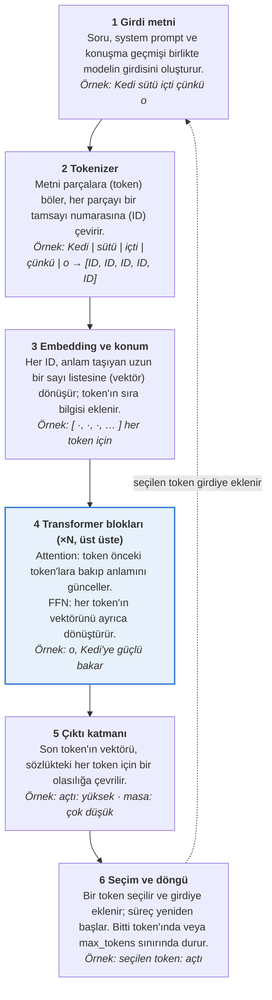
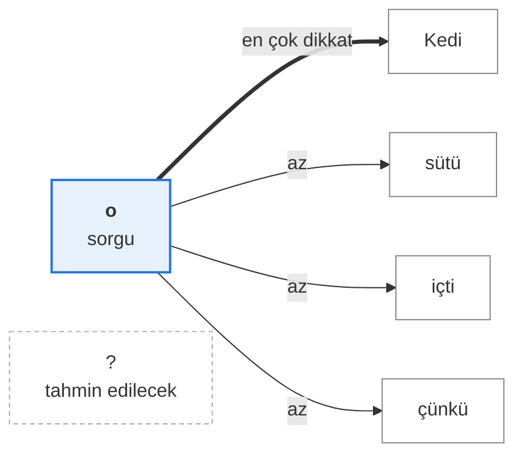

# LLM Nasıl Çalışır: Token, Embedding, Attention

Tarih: 2026-11-12

Büyük dil modelleri (LLM'ler) tek bir iş yapar: elindeki metne bakıp **sıradaki token'ı tahmin eder**, seçtiği token'ı metne ekler ve aynı işi yeniden yapar. Bir cevap, bu tahmin döngüsünün yüzlerce tekrarıdır.

Bu tahmini mümkün kılan üç fikir var: metni sayılara çeviren **token**, sayılara anlam kazandıran **embedding** ve her token'ın bağlama bakmasını sağlayan **attention**. Aşağıdaki şema tüm hattı gösteriyor; sonraki bölümler aynı numaralarla adım adım açıyor.



Şemadaki numaralar başlıklarla eşleşir: **1–2** token, **3** embedding, **4** transformer bloğu ve attention, **5–6** sonraki token'ın seçimi ve döngü. Vurgulu kutu (4) modelin çekirdeğidir. Cevap hattın tek bir turuyla değil, **aynı hattın token token tekrarıyla** yazılır.

## Adım 1–2: Metin token'lara ve numaralara dönüşür

Model metni olduğu gibi okumaz. Girdi (soru, talimat, önceki konuşma) önce **tokenizer**'a verilir. Tokenizer metni **token** denen parçalara böler (kelime, kelime parçası, noktalama, boşluk) ve her token'ı bir tamsayı numarasına (ID) eşler. Modelin gördüğü her şey bu numaralar dizisidir.

Neden kelime ya da harf değil de parça? Her kelimeyi sözlüğe koymak imkânsızdır (sonsuz ek ve türev), harf harf gitmek ise dizileri çok uzatır. Sık geçen parçalar tek token, nadir kelimeler birkaç parça olur.

**Şematik örnek** (gerçek tokenizer çıktısı değil, mantığı göstermek için):

```
"Merhaba dünya"  →  ["Mer", "haba", " dünya"]  →  [ID₁, ID₂, ID₃]
```

Claude'un tokenizer'ının gerçek bölünmesini göremiyorum; yalnızca bir metnin **kaç token** ettiğini API'nin sayım ucuyla (`messages.count_tokens`) ölçebildim.

**Gerçek ölçüm: aynı anlam, Türkçe ve İngilizce** (Claude Haiku 4.5, yaklaşık token sayısı):

| Cümle çifti | Türkçe | İngilizce | Oran |
| --- | --- | --- | --- |
| Günlük cümle (hava, öğrenmeye hazırım) | 31 token (74 karakter) | 18 token (82 karakter) | yaklaşık 1,7 kat |
| Teknik cümle (veritabanı indeksleri) | 30 token (73 karakter) | 11 token (71 karakter) | yaklaşık 2,7 kat |
| Uzun ekli kelime içeren soru | 23 token (45 karakter) | 15 token (60 karakter) | yaklaşık 1,5 kat |

**Yöntem notu:** API her isteğe sabit bir ek yük ekler (tek harfli mesaj 8 token çıktı). Tabloda bu yükü, tek harfi 1 token varsayarak çıkardım; yani sayılar **yaklaşık**tır. Cümleler birebir çeviri olmadığı için oranlar da kesin değil, yalnızca yönü gösteriyor. Üç örnekte de Türkçe daha çok token harcadı.

**Neden?** Bunu kesin bilmiyorum; makul açıklama Türkçenin sondan eklemeli yapısı (bir kelime çok ek alır) ve tokenizer'ın sık geçen parçaları öğrendiği verideki dil dağılımıdır.

**Neden önemli:** Ücret token başına alınır, context window (modelin tek seferde görebildiği toplam token) token ile ölçülür ve cevabın uzunluğu bir token üst sınırıyla (`max_tokens`) sınırlanır. Türkçe metinle çalışırken aynı iş için daha fazla token harcarsın.

## Adım 3: Embedding, token numarası anlam taşıyan sayı listesine dönüşür

Token ID tek başına bir sıra numarasıdır; 5 numaralı token ile 6 numaralı token'ın anlamca yakın olduğunu söylemez. Modelin işlem yapabilmesi için her token, **embedding** denen uzun bir sayı listesine (vektöre) dönüştürülür:

```
token ID  →  [ ·, ·, ·, ·, … ]   (yüzlerce ila binlerce sayı, modele göre değişir)
```

Bu dönüşüm bir arama tablosudur ve değerleri **eğitim sırasında öğrenilir**; elle yazılmaz. Eğitim sonunda benzer bağlamlarda kullanılan token'ların vektörleri birbirine yakın düşer: "kedi" ile "köpek" "tablo"dan daha yakın olur. Anlam, sayıların uzaydaki konumundan gelir.

**İki ince nokta**

- **Aynı token, farklı anlam.** "yüz" kelimesi yüz (surat), yüz (sayı) ya da yüzmek olabilir. İlk embedding bu üçü için aynıdır; doğru anlamı bulan, sonraki adımdaki **attention** katmanlarıdır ve vektörü cümledeki diğer kelimelere göre güncellerler.
- **Sıra bilgisi.** Attention tek başına kelime sırasını bilmez ("dog bites man" ile "man bites dog" aynı kelimelerden oluşur, anlamları tersidir). Bu yüzden embedding'e her token'ın **konum bilgisi** de eklenir; bunun teknik yöntemleri modele göre değişir.

**Başka bir kullanım:** Aynı fikir, bir metnin tümünü tek bir vektöre çevirip anlam yakınlığıyla arama yapmakta da kullanılır (semantik arama). Orada da anlam, uzayda yakınlıktır.

## Adım 4: Transformer blokları ve attention, her token bağlama bakar

Embedding'e dönüşen token'lar **transformer bloklarından** geçer. Her blok iki parçadır: token'lar arasında bilgi taşıyan **attention** ve her token'ın vektörünü tek başına dönüştüren **ileri besleme katmanı (FFN)**. Büyük modellerde bu blok üst üste onlarca ya da daha fazla kez tekrarlanır; her tekrarda vektörler bağlamı biraz daha iyi yansıtır.

Attention, modelin bir token'ın anlamını **cümledeki diğer token'lara bakarak** belirlemesini sağlayan mekanizmadır. Örnek: "Kedi sütü içti çünkü **o** ..." cümlesinde "o"nun kime işaret ettiğini bulmak için modelin "Kedi" kelimesine güçlü, diğerlerine zayıf bakması gerekir.

**Sezgisel işleyiş (her token için)**

1. Token'ın vektöründen üç vektör üretilir: **sorgu** ("neye bakıyorum?"), **anahtar** ("bende ne var?") ve **değer** ("vereceklerim"). Bunlar eğitimde öğrenilen matrislerle çıkarılır.
2. Sorgu, diğer token'ların anahtarlarıyla karşılaştırılır; ne kadar uyuyorsa o kadar yüksek **puan** alır.
3. Puanlar toplamı 1 eden **ağırlıklara** çevrilir.
4. Token'ın yeni vektörü, diğer token'ların **değerlerinin bu ağırlıklarla karışımı** olur.

Sonuç: "o" token'ının vektörü artık "Kedi"den taşıdığı bilgiyle zenginleşmiştir. Aşağıdaki çizim bu bakışı gösteriyor.



Çizim **şematiktir**: çizgi kalınlığı dikkat payını gösterir, gerçek ağırlık değildir. "o" yalnızca kendinden önceki token'lara bakabilir, sonrakini göremez.

Çizimde "o" sorgudur; önceki dört token'a bakar ve "Kedi"ye en çok pay verir. Kesikli kutu, modelin bu bilgiyle üreteceği sonraki token'dır; ona henüz bakılamaz.

**Bilinmesi gereken üç ayrıntı**

- **Çok kafalı (multi-head) attention:** Bu işlem paralel olarak birden çok "kafa" ile yapılır; her kafa farklı bir ilişki türüne bakabilir. Kafaların tam olarak ne yaptığı her zaman net yorumlanamaz.
- **Sadece geriye bakar (causal mask):** Metin üreten LLM'lerde bir token yalnızca kendinden **önceki** token'lara bakabilir, sonrakini göremez. Çünkü görevi sonraki token'ı tahmin etmektir.
- **Maliyet:** Standart attention'da her token diğerlerine baktığı için işlem maliyeti metin uzadıkça hızla artar (kabaca token sayısının karesi gibi). Context window sınırı ve uzun girdilerin pahalı olmasının bir sebebi budur.

## Adım 5–6: Sonraki token seçilir ve döngü başa döner

Transformer blokları son token'ın vektörünü üretir. Çıktı katmanı bu vektörü **sözlükteki her token** için bir puana (logit) çevirir ve puanlar bir **olasılık dağılımına** dönüşür:

```
"Kedi sütü içti çünkü o ___"

  " açtı"        → yüksek olasılık
  " susamıştı"   → yüksek olasılık
  " sevdi"       → düşük
  " masa"        → çok düşük
```

Bu liste **şematiktir**; sayıları uydurmamak için olasılıkları yalnızca "yüksek / düşük" diye gösterdim.

**Hangi token seçilir? (Adım 5)** Ya en olası olan (greedy) ya da dağılımdan **rastgele örnekleme (sampling)** ile. Bu rastgelelik yüzünden aynı soru farklı çalıştırmalarda farklı cevap alabilir. **Temperature** gibi ayarlar dağılımın ne kadar keskin ya da yayık olacağını belirler; hangi ayarların geliştiriciye açık olduğu API'ye ve modele göre değişir.

**Üretim döngüsü (Adım 6, autoregressive).** Seçilen token girdinin sonuna eklenir ve tüm süreç bir sonraki token için yeniden çalışır. Cevap bu şekilde **token token** yazılır. Pratikte önceki hesaplar önbelleğe alınır, yoksa her adımda her şey sıfırdan hesaplanırdı.

**Ne zaman durur?** İki şekilde: model özel bir "bitti" token'ı seçer ya da `max_tokens` sınırına ulaşılır ve cevap yarıda kesilir. Anthropic API'sinde bunlar `stop_reason: end_turn` ve `stop_reason: max_tokens` olarak görünür.

**Çıkarım:** Model "doğru cevabı bilir" diye değil, "bu bağlamda en olası devamı üretir" diye çalışır. Bu yüzden akıcı ve inandırıcı ama yanlış bir cevap (halk arasında "halüsinasyon") üretmesi mümkündür.

## Model bu sayıları nasıl öğrendi?

Yukarıdaki her adımda **öğrenilmiş sayılar** var: embedding tablosu, attention matrisleri, katman ağırlıkları. Hepsine birlikte **parametre** denir ve büyük modellerde milyarlar bulur. Bu sayılar iki ayrı evrede kazanılır, sonra sabit kalır:

| Evre | Ne olur | Ne zaman |
| --- | --- | --- |
| **Ön eğitim (pretraining)** | Model çok büyük bir metin yığınında "sonraki token'ı tahmin et" görevini yapar. Tahmin yanlışsa parametreler biraz ayarlanır. Bu işlem çok kez tekrarlanır | Model geliştirilirken, bir kez ve çok pahalıya |
| **Sonraki eğitim (talimata uyum)** | Model, yardımcı ve güvenli davranması için ek verilerle ve geri bildirimle yeniden ayarlanır. Yöntemler geliştiriciye göre değişir | Model yayınlanmadan önce |
| **Kullanım (çıkarım, inference)** | Parametreler **sabittir**; model sizinle konuşurken hiçbir şey öğrenmez, yalnızca girdideki token'lara bakıp sonraki token'ları üretir | Modeli her kullandığınızda |

Bu ayrımın üç sonucu var: model **sizi hatırlamaz** (tek hafızası o istekteki konuşmadır; API'ler bu yüzden "durumsuz", yani stateless çalışır), **bilgisi eğitim verisiyle sınırlıdır** (güncel ya da özel bilgiyi ona siz vermelisiniz; araç kullanımı ve arama gibi yöntemler bunun içindir) ve **context window bir üst sınırdır** (attention yalnızca o pencerenin içindeki token'lara bakabilir; sığmayan bilgi modele hiç ulaşmaz).

## Pratikte bu ne anlama gelir?

LLM'lerle çalışırken karşılaştığın şaşırtıcı davranışların çoğu bu hattın doğrudan sonucudur:

| Ne görürsün | Neden |
| --- | --- |
| Fiyat ve limitler token ile ölçülür; Türkçe aynı iş için daha çok token harcar | Model her şeyi token'larla yapar; tokenizer Türkçeyi daha çok parçaya böler (Adım 1–2) |
| Model önceki konuşmayı hatırlamaz; her istekte tüm geçmiş gönderilir | Parametreler çağrıdan çağrıya değişmez, tek hafıza context window'dur |
| Uzun konuşmalarda maliyet ve süre hızla artar | Her tur tüm geçmişi yeniden işler; standart attention'ın maliyeti uzunlukla hızla büyür (Adım 4) |
| Cevap yarıda kesilebilir | Üretim, "bitti" token'ı seçilince ya da `max_tokens` sınırında durur (Adım 6) |
| Aynı soru farklı çalıştırmalarda farklı cevap verebilir | Token'lar olasılık dağılımından seçilir (Adım 5) |
| Akıcı ama yanlış cevap (halüsinasyon) | Model en olası devamı üretir, doğruluğunu değil (Adım 5–6) |
| Güncel ya da özel bilgiyi bilmez | Parametreler eğitim verisiyle sabit; bilgiyi ona sen vermelisin |
| Prompt'taki bilginin context window'a sığması gerekir | Attention yalnızca penceredeki token'lara bakabilir (Adım 4) |

## Kaynaklar ve bu anlatımın sınırları

**Daha derine inmek için**

- [Andrej Karpathy, "Intro to Large Language Models"](https://www.youtube.com/watch?v=zjkBMFhNj_g) (~1 saat) ve ["Deep Dive into LLMs like ChatGPT"](https://www.youtube.com/watch?v=7xTGNNLPyMI) (3 saat 31 dk): kodsuz, kavramsal anlatım. Başlık ve süreleri web aramasıyla gördüm; YouTube sayfalarını açıp doğrulayamadım
- ["Attention Is All You Need"](https://arxiv.org/abs/1706.03762) (Vaswani ve diğerleri, 2017): transformer mimarisini tanıtan makale. Adresi bildiğim kadarıyla yazdım, açıp doğrulamadım
- 3Blue1Brown'un sinir ağları ve transformer videoları: görsel anlatım (adını hatırladığım kadarıyla yazdım, bölüm başlıklarını doğrulamadım)

**Bu anlatımın sınırları**

- Genel bir metin üreten (decoder tabanlı) transformer LLM'i anlatıyor. **Claude'un iç mimarisinin ayrıntılarını bilmiyorum**; burada yazılanlar bütün bu tür modellerin ortak ilkeleridir.
- Bilerek basitleştirdim: katman normalizasyonu, artık (residual) bağlantılar, farklı konum kodlama yöntemleri ve eğitim ayrıntıları anlatılmadı.
- Çizimlerdeki ve örneklerdeki olasılık, ağırlık ve token bölünmeleri şematiktir; tek gerçek ölçüm, Adım 1–2'deki token sayılarıdır.
